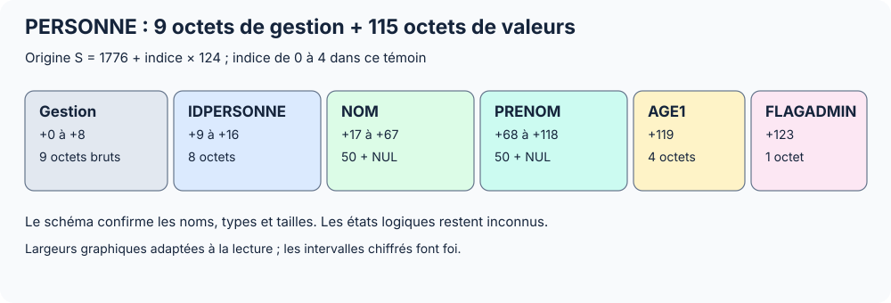

## Lire le schéma WDD

```csharp
using WindevReader;

var analyse = WddWindevAnalysis.Open("SuperNoteExtra.wdd");
foreach (var table in analyse.Tables)
{
    Console.WriteLine($"{table.Name}, longueur brute : {table.RawRecordByteLength}");
    foreach (var rubrique in table.Fields)
        Console.WriteLine($"{rubrique.Name}: {rubrique.Type}, " +
            $"déclaré {rubrique.Size}, stocké {rubrique.StorageSize}");
}

foreach (var liaison in analyse.Relations)
    Console.WriteLine($"{liaison.SourceTable}.{liaison.SourceField} -> " +
        $"{liaison.TargetTable}.{liaison.TargetField}");
```

`Relations` expose le profil non vide 28 étudié. Les cardinalités et les règles de contrainte restent des mots bruts dans `RawFlags` ; consulter les diagnostics pour un profil non pris en charge.

`RawRecordByteLength` est un mot du schéma. La correspondance avec un pas physique a été recoupée sur PERSONNE 28 ; cette propriété n’active pas un lecteur universel de FIC.

## Vérifier que le FIC correspond à l’analyse

```csharp
var fic = FicHfsqlDataFile.Open("PERSONNE.fic");
var index = NdxHfsqlIndexFile.Open("PERSONNE.ndx");
Console.WriteLine(fic.HasSameIdentityAs(index)); // comparaison des deux GUID
Console.WriteLine(fic.MatchesAnalysis(analyse)); // GUID d’analyse
var definition = fic.FindTableDefinition(analyse); // null si incompatibles
```

Les noms de fichiers ne prouvent pas cette association. `FindTableDefinition` exige le GUID d’analyse et le GUID de table. Une correspondance ne déchiffre pas les données et ne vérifie pas un mot de passe.

## Lire PERSONNE avec les noms du schéma

Avec le WDD correspondant, la bibliothèque 0.5.0 peut construire la disposition des rubriques fixes. Dans le témoin, le premier emplacement commence à **1 776** et le fichier contient **cinq emplacements**. Ces deux paramètres viennent de l’étude physique ; l’API ne les découvre pas.

```csharp
var disposition = fic.CreateFixedRecordLayout(analyse,
    dataOffset: 1776, recordCount: 5);

var emplacements = fic.ReadFixedRecords(disposition);
foreach (var emplacement in emplacements)
{
    Console.WriteLine($"Offset {emplacement.Offset} : " +
        $"{emplacement.Values["NOM"]}, " +
        $"{emplacement.Values["PRENOM"]}, " +
        $"âge {emplacement.Values["AGE1"]}, " +
        $"admin {emplacement.Values["FLAGADMIN"]}");
}
```

Pour ce profil, `IDPERSONNE` devient un `long`, `NOM` et `PRENOM` des `string`, `AGE1` un `int` et `FLAGADMIN` un `bool`. Les noms viennent du schéma, même si les valeurs saisies semblent inverser prénom et nom. Le lecteur n’altère pas les valeurs pour les faire correspondre à une convention humaine.

La construction vérifie les GUID, les versions concordantes 28 ou 31, les types et tailles pris en charge, le préfixe observé de neuf octets, le pas annoncé et les bornes physiques. Elle refuse les mémos et types non pris en charge. PERSONNE_MESSAGE est décrite dans le WDD mais son mémo TEXTE n’est pas un champ texte fixe ; ses données physiques n’ont pas été fournies.



## Fournir sa propre disposition

Lorsque la disposition est déjà connue, la méthode historique reste disponible. Les noms et types ci-dessous sont alors choisis par l’appelant.

```csharp
var manuelle = new HfsqlFixedRecordLayout(1776, 124, 5,
    new HfsqlFixedField[] {
        new("IdentifiantBrut", 9, 8, HfsqlFixedFieldType.Int64),
        new("TexteA", 17, 51, HfsqlFixedFieldType.Cp1252Z)
    });
var vue = fic.ReadFixedRecords(manuelle);
Console.WriteLine(vue[0].Values["TexteA"]);
```

La vue valide et copie les définitions de champs, puis décode un emplacement à chaque accès. `SlotIndex` commence à zéro ; `Offset` est absolu dans le FIC. `RawData` de l’emplacement conserve ses octets exacts. Les champs peuvent se recouvrir pour permettre plusieurs lectures explicites d’une même zone.

## Ce que cette lecture ne décide pas

Les cinq emplacements incluent une valeur d’identifiant tout à 1, lue -1 en `Int64`. Les états actif, rayé et supprimé restent inconnus : aucun emplacement n’est filtré et le nombre 5 n’est pas un compte de personnes actives.

`CanReadRecords` reste `false` pour la découverte automatique complète. `ReadFixedRecords` fournit une capacité explicite distincte. `PasswordStatus` reste `Unknown`, y compris pour un fichier déclaré sans mot de passe par son propriétaire : le lecteur ne déduit pas ce statut du seul en-tête.

## Examiner NDX, MMO et WDA

`index.IndexDescriptors` donne les descripteurs de 60 octets et leurs pointeurs bruts. `ReadIndexRegion(i)` renvoie les octets entre deux descripteurs terminaux ; ce n’est pas une reconstruction de l’index logique.

`MmoHfsqlMemoFile.Open` expose l’en-tête et `RawHeaderSlots`, sans suivre l’allocation des mémos. `WdaWindevAnalysisSource.Open` expose les sections et buffers décompressés de l’analyse éditable ; l’accès typé aux tables passe par le WDD.


## Profils fixes WINDEV 31

```csharp
var jours = FicHfsqlDataFile.Open("jour_ferie.fic");
var joursLignes = jours.ReadFixedRecords(
    jours.CreateFixedRecordLayout(analyse, 1763, 8));

var semaines = FicHfsqlDataFile.Open("semaine_cours.fic");
var semainesLignes = semaines.ReadFixedRecords(
    semaines.CreateFixedRecordLayout(analyse, 1627, 1));
Console.WriteLine(semainesLignes[0].Values["DATEDEB"]); // "20260504"

var indexJours = NdxHfsqlIndexFile.Open("jour_ferie.ndx");
foreach (var entree in indexJours.ReadFlatIndex(3).Entries)
    Console.WriteLine($"{entree.KeyHex}: {entree.RawReference1}");
```

Utiliser ici le WDD 31 qui décrit ces deux tables. La clé composée MOISJOUR est omise de la disposition FIC : elle n’a pas de valeur physique supplémentaire. JOUR et MOIS deviennent des `byte`. Les dates `Date8Z` restent des `string` de huit chiffres, avec un NUL obligatoire dans le stockage. Le lecteur ne valide pas le calendrier et ne convertit pas ces chaînes en horodatages.

`ReadFlatIndex` restitue les clés brutes (`Key`, `KeyHex`) et deux références (`RawReference1`, `RawReference2`). La sentinelle finale est contrôlée puis exclue ; `DeclaredEntryCount` la compte. Aucun nom de rubrique n’est inféré automatiquement. La nature des deux références reste ouverte : dans ces témoins, identifiants et rangs physiques coïncident. Le parcours général du B-tree n’est pas implémenté.
