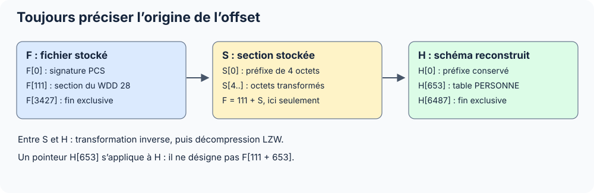

Un offset indique une position en octets, à partir de zéro. Avant de suivre un pointeur, identifier le buffer auquel il appartient : le fichier stocké et son contenu décompressé n’ont pas les mêmes coordonnées.

| Repère | Origine | Exemple | Conversion |
| --- | --- | --- | --- |
| `F` | Début du fichier | `F[111]` | Offset absolu |
| `S` | Début d’une section stockée | `S[4]` | `F = début_section + 4`, uniquement avant transformation |
| `H` | Début du schéma WDD reconstruit | `H[653]` | Pointeur dans le buffer ; aucune addition directe à l’offset fichier |
| `S + r` dans une ligne FIC | Début physique de l’emplacement | `S + 119` | `F = début_données + indice × pas + 119` |

## Types primitifs

| Notation | Taille | Sens |
| --- | --- | --- |
| `u8` / `i8` | 1 octet | Entier non signé / signé sur 8 bits |
| `u16` / `i16` | 2 octets | Entier sur 16 bits |
| `u32` / `i32` | 4 octets | Entier sur 32 bits |
| `u64` / `i64` | 8 octets | Entier sur 64 bits |
| ASCII Z / CString | Variable | Octets jusqu’au NUL inclus |
| `octets[n]` | `n` octets | Données sans interprétation supplémentaire |

Les entiers étudiés sont en **petit-boutiste** : `7C 00 00 00` représente 124 en `u32`. Lire ces quatre octets dans l’autre sens donne une valeur incorrecte. Un octet compte 8 bits ; un `u32` occupe quatre octets.

L’intervalle `[90, 584)` commence à 90 et s’arrête avant 584 : il mesure 494 octets. Les nombres décimaux sont la référence ; un équivalent hexadécimal peut être ajouté sous la forme `0x6F`.

## Distinguer constat et interprétation

| Formulation | Ce qu’elle garantit |
| --- | --- |
| Valeur lue | Les octets et le découpage indiqué sont vérifiables |
| Champ confirmé par le schéma | Le WDD fournit le nom, le type ou la taille correspondante |
| Profil observé | La structure est validée sur les témoins cités |
| Inférence | Explication plausible qui demande un autre recoupement |
| Opaque / brut | Les octets sont conservés ; leur rôle n’est pas établi |

Une taille de 124 rencontrée à deux endroits est un recoupement utile, pas une preuve que tous les FIC utilisent ce pas. Une suite de zéros n’est pas automatiquement une zone libre.

## Exemples fictifs

Les noms applicatifs sont anonymisés. **Le logiciel de prise de note SuperNoteExtra** et **le logiciel de client mail SuperMailExtra** sont fictifs. Les chemins, GUID applicatifs et valeurs textuelles illustratives sont remplacés ; les constantes techniques du format restent exactes.

Les tableaux numériques conservent les positions mesurées dans les profils étudiés. Remplacer un texte de longueur variable dans un vrai fichier déplacerait les positions suivantes : les exemples anonymisés ne constituent donc pas des fichiers binaires reconstruits. `PERSONNE` et ses rubriques sont des noms techniques du témoin générique ; ses valeurs textuelles illustratives sont fictives.
