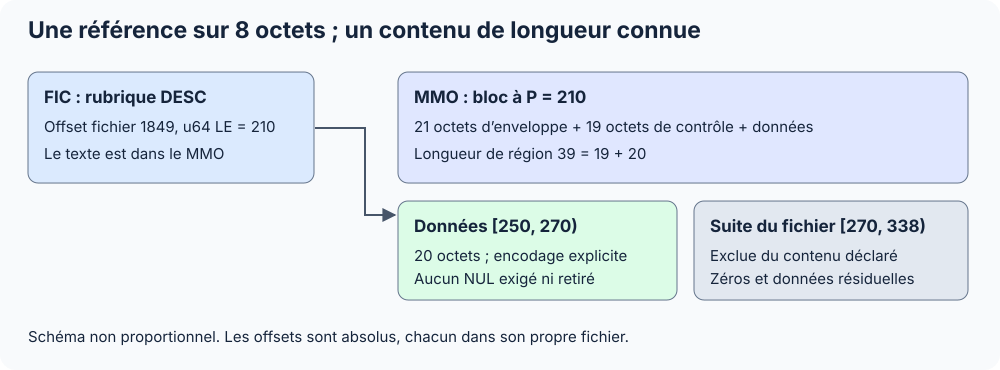
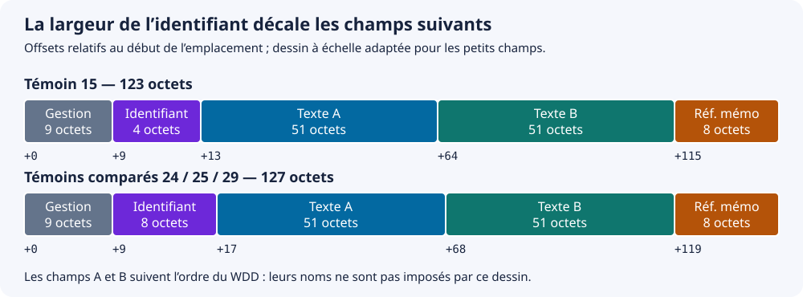

Le FIC stocke les valeurs et des structures de gestion. Un emplacement physique n’est pas nécessairement un enregistrement actif. Le cas PERSONNE fournit un profil fixe dont les rubriques sont maintenant confirmées par le WDD.

Les positions sont exprimées en **octets**. Les inconnues sont indiquées comme telles ; voir les [conventions](../conventions.mdx).

## Structure reconnue

Le type `0x00070001` identifie les FIC étudiés. Les 90 premiers octets suivent l’[en-tête physique commun](./en-tete.mdx). Le reste demeure disponible dans `UninterpretedBody`.

Les tailles des rubriques du WDD ne suffisent pas à découper le FIC en lignes : il faut aussi connaître les structures de gestion, les états d’enregistrement, les valeurs variables et la protection éventuelle.

## Carte du profil RADFic.FIC

| Intervalle fichier, fin exclue | Taille | Type documentaire | Contenu / commentaire |
| --- | --- | --- | --- |
| `[0, 20)` | 20 | En-tête PCS | Type FIC |
| `[20, 53)` | 33 | `CString` | GUID de l’analyse propriétaire |
| `[53, 86)` | 33 | `CString` | GUID de table, commun au NDX associé |
| `[86, 90)` | 4 | `u16 + u8 + u8` | Valeurs 0, 1, 0 dans le profil |
| `[90, 802)` | 712 | `octets[712]` | Région opaque, transformation non établie |
| `[802, 1826)` | 1 024 | `octets[1024]` | Octets nuls |
| `[1826, 1830)` | 4 | `u32` brut | Valeur 1, sans sémantique de compte certifiée |
| `[1830, 1862)` | 32 | `octets[32]` | Octets nuls |
| `[1862, 1870)` | 8 | `u64` brut | Sentinelle `0xFFFFFFFFFFFFFFFF` |
| `[1870, 1918)` | 48 | `octets[48]` | Région finale opaque |
| 1 918 | 0 | Fin exclusive | Taille du fichier complet |

Ces frontières sont constatées par lecture des octets. Une région nulle n’est pas automatiquement une page libre ou un tableau d’enregistrements.

## Variations observées

| Profil | Taille fichier | Début de la première longue région nulle | Région opaque depuis 90 |
| --- | --- | --- | --- |
| RADFic.FIC | 1 918 | 802 | 712 octets |
| RADRub.FIC | 1 985 | 862 | 772 octets |
| RADProp.FIC | 1 672 | 579 | 489 octets |

Le quatrième contenu FIC distinct, celui des tâches, mesure 2 582 octets. La position 802 n’est pas un début de données universel.

## Protection et résultats des essais

La transformation WDD utilisée telle quelle n’a pas fourni de structure FIC validée. Le paramètre fixe des métadonnées WDL n’a pas non plus donné de structure validée dans les régions FIC examinées. Ces essais bornés n’identifient pas l’algorithme de protection et ne constituent pas une recherche exhaustive de mot de passe.

Pour les fichiers RAD, le corps reste brut ; aucun mot de passe n’est exposé. Le GUID d’analyse RAD diffère de celui du WDD applicatif fourni, qui ne peut pas être appliqué arbitrairement à ces octets.

## API

```csharp
FicHfsqlDataFile file = FicHfsqlDataFile.Open(@"D:\Projet\SuperNoteExtra\RADFic.FIC");

Console.WriteLine(file.Header.TableGuid);

Console.WriteLine(file.PasswordStatus); // Unknown

ReadOnlyMemory<byte> corps = file.UninterpretedBody;
```

Une ouverture réussie valide les champs pris en charge, pas la découverte automatique des enregistrements. `ReadFixedRecords(layout)` permet désormais une lecture des emplacements en clair lorsque l’appelant connaît leurs positions et types. Le profil PERSONNE 28 détaillé ci-dessous donne une disposition vérifiée de cinq emplacements de 124 octets. Cette disposition ne s’applique pas aux fichiers RAD et ne reconstitue pas leur schéma.


## Relier les valeurs au schéma

Dans le cas PERSONNE 28, le WDD confirme IDPERSONNE (8 octets), NOM (51 octets stockés pour 50 déclarés), PRENOM (51), AGE1 (4), FLAGADMIN (1). Le pas de 124 est présent dans le WDD et le WDA. La lecture n’a plus besoin de noms ou de types de travail ; elle conserve un début de données et un compte explicites.

Le [guide .NET](../../dotnet/schema-et-donnees.mdx) utilise `CreateFixedRecordLayout`. La carte ci-dessous conserve la carte du fichier et des octets de gestion. Le profil de neuf octets de préfixe est vérifié sur ce témoin ; il n’est pas généralisé aux FIC opaques RAD.


## Extension aux valeurs 31

Les nouveaux témoins JOUR_FERIE et SEMAINE_COURS reprennent le préfixe observé de neuf octets. Leurs pas sont 70 et 35, avec des débuts de données à 1763 et 1627. Les dates stockent huit chiffres ASCII suivis de NUL. Une clé composée du schéma, MOISJOUR, n’occupe aucun octet de valeur supplémentaire dans le FIC. Les tableaux ci-dessous donnent les offsets FIC ; les [clés correspondantes](./ndx.mdx) sont décrites dans NDX.


## Références de mémo en 29

Le nouveau PERSONNE 29 a un pas de 127 et une rubrique DESC de type mémo texte. Ses huit octets deviennent une référence `ulong`, égale à 210 dans le témoin. Le contenu se lit séparément dans le MMO, avec encodage explicite et vérification des deux GUID. La disposition et les positions sont détaillées ci-dessous.

## FIC : une référence vers le MMO

Les deux GUID du WDD correspondent à ceux des trois fichiers physiques. Les modes bruts à 88/89 sont nuls et les flags à 86 valent `0x8000`, sans déduction de statut de mot de passe.

| Intervalle fichier | Taille | Rôle reconnu |
| --- | --- | --- |
| `[0, 90)` | 90 | En-tête commun |
| `[90, 535)` | 445 | Métadonnées opaques |
| `[535, 1559)` | 1 024 | Octets nuls |
| `[1559, 1603)` | 44 | Mots de gestion non interprétés |
| `[1603, 1730)` | 127 | Région opaque de la longueur du pas |
| `[1730, 1857)` | 127 | Un emplacement de données en clair |

Pour cet emplacement, `S = 1730` :

| Offset relatif | Offset fichier | Taille | Type / rubrique |
| --- | --- | --- | --- |
| `S+0` | 1 730 | 9 | Gestion brute ; état logique non certifié |
| `S+9` | 1 739 | 8 | IDPERSONNE, lecture `i64` LE, valeur 1 |
| `S+17` | 1 747 | 51 | NOM, CP1252 Z |
| `S+68` | 1 798 | 51 | PRENOM, CP1252 Z |
| `S+119` | 1 849 | 8 | DESC, `u64` LE : **210** |

`9 + 8 + 51 + 51 + 8 = 127`, ce qui correspond au WDD. Le début 1730 et le nombre 1 restent des paramètres explicites du lecteur de disposition.



## Carte et emplacements PERSONNE 28

| Intervalle absolu | Taille | Type de lecture | Commentaire |
| --- | --- | --- | --- |
| `[0, 90)` | 90 | En-tête commun | Voir ci-dessus |
| `[90, 584)` | 494 | Octets opaques | Pas de schéma ni codec validé |
| `[584, 1592)` | 1 008 | Octets nuls | Cette région ne fait pas 1 024 octets ; ne pas calquer le profil RAD |
| `[1592, 1652)` | 60 | Mots bruts | Tableau suivant ; sémantiques non validées |
| `[1652, 1776)` | 124 | Octets opaques | La longueur égale le pas des emplacements ; ce rapprochement ne prouve pas un enregistrement chiffré ou un modèle |
| `[1776, 1900)` | 124 | Emplacement physique 0 | Début de la répétition vérifiée |
| `[1900, 2024)` | 124 | Emplacement physique 1 | Identifiant brut 3 |
| `[2024, 2148)` | 124 | Emplacement physique 2 | Identifiant brut 4 |
| `[2148, 2272)` | 124 | Emplacement physique 3 | Identifiant brut 5 |
| `[2272, 2396)` | 124 | Emplacement physique 4 | Identifiant brut tout à 1 |
| 2 396 | 0 | Fin exclusive | `1776 + 5 × 124` |

### Mots de gestion observés

Les découpages `u64` ci-dessous sont des lectures documentaires. Sans recoupement indépendant, ces valeurs ne sont pas exposées comme des compteurs certifiés dans l’API.

| Offset fichier | Taille | Type de lecture | Valeur | Commentaire |
| --- | --- | --- | --- | --- |
| 1 592 | 8 | `u64` brut | 1 | Sens inconnu |
| 1 600 | 8 | `u64` brut | `0x7FFFFFFFFFFFFFFF` | Sentinelle possible, non qualifiée |
| 1 608 | 4 | `u32` brut | 11 | Sens inconnu |
| 1 612 | 8 | `u64` brut | 1 | Sens inconnu |
| 1 620 | 8 | `u64` brut | 4 | Ne suffit pas à prouver quatre lignes actives |
| 1 628 | 8 | `u64` brut | 0 | Sens inconnu |
| 1 636 | 8 | `u64` brut | 5 | Coïncide avec le nombre de répétitions ; pas un compteur universel établi |
| 1 644 | 8 | `u64` brut | 2 | Sens inconnu |

### Disposition d’un emplacement

Pour `i` entre 0 et 4, `S = 1776 + 124 × i`. Les champs suivants couvrent exactement les 124 octets. Le WDD confirme maintenant les noms `NOM`, `PRENOM`, `AGE1`, `FLAGADMIN` et leurs tailles. Les neuf octets de gestion restent bruts.

| Offset relatif à `S` | Offset absolu du premier | Taille | Interprétation de lecture | Valeur/commentaire |
| --- | --- | --- | --- | --- |
| `+0` | 1 776 | 1 | `u8` brut | `0x10` dans le premier, `0x80` dans les quatre suivants ; état logique non attribué |
| `+1` | 1 777 | 2 | `u16` brut | 1 puis 2 dans les quatre suivants |
| `+3` | 1 779 | 4 | `u32` brut | `0x6A835C67` puis `0x6A835D9A` ; pas de conversion en date validée |
| `+7` | 1 783 | 1 | `u8` brut | 0 |
| `+8` | 1 784 | 1 | `u8` brut | `0xFF` |
| `+9` | 1 785 | 8 | `i64` explicite | 1, 3, 4, 5, -1 selon l’emplacement |
| `+17` | 1 793 | 51 | `NOM`, texte 50 + NUL | Exemple fictif `Lina` ; ASCII observé, CP1252 choisi explicitement par le lecteur |
| `+68` | 1 844 | 51 | `PRENOM`, texte 50 + NUL | Exemple fictif `Morel` |
| `+119` | 1 895 | 4 | `AGE1`, `i32` | 18 dans les cinq emplacements |
| `+123` | 1 899 | 1 | `FLAGADMIN`, booléen sur un octet | 0, faux dans les cinq emplacements |

Le champ à `+9` contient exactement `FF FF FF FF FF FF FF FF` dans le dernier emplacement. Une lecture `i64` donne -1 ; une lecture `u64` donne 18 446 744 073 709 551 615. La représentation binaire est certaine, son rôle de sentinelle ou d’identifiant logique ne l’est pas. Le nom IDPERSONNE et son type identifiant automatique sur huit octets sont confirmés par le WDD. Le lecteur conserve une interprétation `Int64` de ce profil, qui rend visible la valeur brute -1 sans l’assimiler à une personne active.

Les deux chaînes ont chacune une zone fixe de 51 octets. La description WDD confirme désormais une taille déclarée de 50 et une taille de stockage de 51. Les octets ASCII ne suffisent pas à distinguer CP1252 des autres encodages compatibles avec ASCII.

### États et nombre de personnes

La documentation officielle distingue les enregistrements [actifs, rayés et supprimés](https://doc.pcsoft.fr/fr-FR/?3044006=), et précise que [l’ajout peut réutiliser les emplacements supprimés](https://doc.pcsoft.fr/?3044147=). Elle ne fournit pas les valeurs binaires des états de ce profil. L’absence d’identifiant 2, la présence de -1 et les octets `0x10`/`0x80` ne suffisent donc pas à attribuer un état fiable à chaque emplacement.

Le lecteur restitue **cinq emplacements physiques**, sans les filtrer, sans les compter comme cinq personnes actives et sans présenter `SlotIndex` comme le numéro d’enregistrement HFSQL.

## Schéma confirmé et lecture .NET


Le WDD décrit cinq rubriques. Leur stockage cumulé vaut `8 + 51 + 51 + 4 + 1 = 115` octets ; avec les neuf octets de gestion, on retrouve exactement 124. Le WDA fournit indépendamment la même longueur. Les positions 1 776 et le compte 5 viennent toujours de l’inspection du FIC : ils ne sont pas retrouvés automatiquement.

La bibliothèque 0.4.0 propose `CreateFixedRecordLayout(analyse, 1776, 5)`. Elle vérifie les GUID, les types, les largeurs et la cohérence du pas, puis fournit des champs nommés. Le guide [schéma et données .NET](../../dotnet/schema-et-donnees.mdx) contient l’exemple complet. Les dispositions manuelles de la version précédente restent acceptées.

Le WDD contient aussi PERSONNE_MESSAGE, avec trois rubriques : IDPERSONNE_MESSAGE, IDPERSONNE, TEXTE. TEXTE est un mémo texte : ses huit octets de stockage ne sont pas un texte de huit caractères. Aucun fichier physique de cette seconde table n’a été fourni. La liaison entre les deux tables est détaillée dans le [format WDD](../windev/wdd.mdx#première-liaison-non-vide).

## Carte des deux FIC

Les intervalles sont absolus dans le fichier, avec fin exclue. Les neuf octets de gestion de chaque emplacement précèdent les valeurs.

| Région | jour_ferie.fic | Taille | semaine_cours.fic | Taille | Lecture |
| --- | --- | --- | --- | --- | --- |
| En-tête | `[0, 90)` | 90 | `[0, 90)` | 90 | Champs PCS et GUID |
| Région initiale opaque | `[90, 625)` | 535 | `[90, 524)` | 434 | Transformation non déterminée |
| Région nulle | `[625, 1649)` | 1 024 | `[524, 1548)` | 1 024 | Octets nuls |
| Mots de gestion | `[1649, 1693)` | 44 | `[1548, 1592)` | 44 | Voir tableau suivant |
| Région opaque de la longueur du pas | `[1693, 1763)` | 70 | `[1592, 1627)` | 35 | Son rôle de modèle/valeurs initiales n’est pas confirmé |
| Emplacements en clair | `[1763, 2323)` | `8 × 70` | `[1627, 1662)` | `1 × 35` | Frontières recoupées avec le WDD |

### Mots de gestion

Soit `G = 1649` pour les jours fériés, ou `G = 1548` pour la semaine.

| Offset relatif | Taille | Type de lecture | Jours fériés | Semaine | Interprétation |
| --- | --- | --- | --- | --- | --- |
| `G+0` | 4 | `u32` brut | 9 | 2 | Coïncide ici avec le prochain identifiant ; rôle non certifié |
| `G+4` | 8 | `u64` brut | 8 | 1 | Coïncide avec le nombre d’emplacements lus |
| `G+12` | 8 | `u64` brut | 0 | 0 | Rôle non attribué |
| `G+20` | 8 | `u64` brut | 0 | 0 | Rôle non attribué |
| `G+28` | 8 | `u64` brut | 8 | 1 | Coïncide avec le nombre d’emplacements lus |
| `G+36` | 8 | `u64` brut | Tout à 1 | Tout à 1 | Sentinelle sans rôle attribué |

Ces coïncidences renforcent des hypothèses de compteurs, mais ne suffisent pas à les utiliser comme méthode universelle de localisation. Le lecteur conserve donc un début et un nombre d’emplacements explicites. Les valeurs PERSONNE, après modifications/suppressions possibles, ne se réduisent pas aux mêmes égalités.

## JOUR_FERIE : valeurs et clé composée

Le WDD annonce cinq rubriques mais seulement quatre occupent une zone de valeurs dans le FIC. Pour l’emplacement `i`, `S = 1763 + i × 70`, avec `i` de 0 à 7.

| Offset relatif | Premier offset absolu | Taille | Nom / type | Commentaire |
| --- | --- | --- | --- | --- |
| `S+0` | 1 763 | 9 | Gestion brute | Premier octet `0x10` dans les huit emplacements ; état non certifié |
| `S+9` | 1 772 | 8 | IDJOUR_FERIE, lecture `i64` LE | Valeurs 1 à 8 |
| `S+17` | 1 780 | 1 | JOUR, `u8` | Jour du mois |
| `S+18` | 1 781 | 1 | MOIS, `u8` | Mois |
| `S+19` | 1 782 | 51 | LIBELLE, CP1252 Z | Taille déclarée 50, stockage 51 ; accents recoupés |
| Aucun | Aucun | 0 dans le FIC | MOISJOUR, clé composée | Présente dans le schéma et l’index, pas comme valeur supplémentaire |

La clé composée est identifiée par les métadonnées du [WDD](../windev/wdd.mdx#clé-composée-et-rubrique-binaire).

`8 + 1 + 1 + 51 + 9 = 70`. Ajouter les quatre octets de métadonnée de stockage de MOISJOUR donnerait 74, en contradiction avec le WDD et les répétitions du FIC. Le lecteur de disposition omet cette clé composée et ne crée pas une valeur synthétique dans `Values`.

## SEMAINE_COURS : dates sur neuf octets

| Offset relatif à 1 627 | Offset absolu | Taille | Nom / type | Valeur lue |
| --- | --- | --- | --- | --- |
| `+0` | 1 627 | 9 | Gestion brute | Non interprétée |
| `+9` | 1 636 | 8 | IDSEMAINE_COURS, lecture `i64` LE | 1 |
| `+17` | 1 644 | 9 | DATEDEB, huit chiffres ASCII + NUL | `20260504` |
| `+26` | 1 653 | 9 | DATEFIN, huit chiffres ASCII + NUL | `20260508` |

Le WDD confirme le code de type 14, une taille déclarée 8 et un stockage 9. L’API explicite `Date8Z` retourne une chaîne de huit chiffres, sans conversion en fuseau horaire ou en horodatage. Elle vérifie les huit chiffres et le NUL ; la validation du calendrier est laissée à l’appelant. Le format logique AAAAMMJJ est aussi décrit dans la [documentation PC SOFT des requêtes](https://doc.pcsoft.fr/fr-fr/?1000024948=), sans y préciser ce stockage physique de neuf octets.

## PERSONNE 25 : même disposition, début décalé

Le FIC 25 mesure **1 873 octets**. Les GUID correspondent au WDD, au NDX et au MMO 25 fournis, pas aux autres tables homonymes. Le WDD donne un pas de **127 octets**. Le début vérifié est **1 746**, contre 1 730 dans le témoin 29 ; il reste un paramètre explicite de `CreateFixedRecordLayout`.

| Région dans `F` | Taille | Lecture / commentaire |
| --- | --- | --- |
| `[0,90)` | 90 | En-tête commun ; version `u16 = 25` à 14 |
| `[90,551)` | 461 | Métadonnées opaques ; 16 octets de plus que le témoin 29 |
| `[551,1575)` | 1 024 | Région nulle |
| `[1575,1619)` | 44 | Mots de gestion non attribués |
| `[1619,1746)` | 127 | Région opaque de la longueur du pas |
| `[1746,1873)` | 127 | Un emplacement en clair |

| Champ | Offset relatif à S=1746 | Offset fichier | Taille | Type de lecture |
| --- | --- | --- | --- | --- |
| Gestion brute | 0 | 1 746 | 9 | `octets[9]`, état logique non certifié |
| IDPERSONNE | 9 | 1 755 | 8 | `i64` LE, valeur 1 |
| NOM | 17 | 1 763 | 51 | CP1252 Z, taille déclarée 50 |
| PRENOM | 68 | 1 814 | 51 | CP1252 Z, taille déclarée 50 |
| DESC | 119 | 1 865 | 8 | `u64` LE, référence de mémo **210** |

Le préfixe commence par `0x10`, sans attribution automatique d’état actif. Les textes personnels du témoin ne sont pas reproduits. Une substitution fictive, par exemple « Martin » et « Camille », illustre deux chaînes de six et sept caractères sans changer les largeurs de stockage.

Les six mots de gestion à G=1575 sont lus comme `u32` à G+0, puis `u64` à G+4, G+12, G+20, G+28 et G+36 : valeurs 2, 1, 0, 0, 1 et tout à 1. Ce sont les mêmes valeurs que le témoin 29 ; elles ne constituent pas une méthode universelle de découverte des emplacements.

`9 + 8 + 51 + 51 + 8 = 127` concorde avec le WDD et la fin du fichier. Aucun changement de taille de champ n’est nécessaire ; c’est la région précédant les emplacements qui change. Les [blocs MMO](./mmo.mdx) et les [clés NDX](./ndx.mdx) recoupent la référence 210 et l’identifiant 1.

## PERSONNE 24 : début à 1734 et ordre des rubriques

Le FIC 24 mesure **1 861 octets**. Ses deux GUID correspondent au WDD, au NDX et au MMO 24. Le WDD confirme un emplacement de **127 octets**, mais le début est **1734**, contre 1746 dans le témoin 25 et 1730 en 29. Ces positions restent fournies explicitement à la bibliothèque.

| Région fichier | Taille | Interprétation |
| --- | --- | --- |
| `[0,90)` | 90 | En-tête physique commun, version `u16 = 24` à 14 |
| `[90,539)` | 449 | Métadonnées opaques |
| `[539,1563)` | 1 024 | Octets nuls |
| `[1563,1607)` | 44 | Mots de gestion non attribués |
| `[1607,1734)` | 127 | Région opaque de la longueur du pas |
| `[1734,1861)` | 127 | Un emplacement en clair |

| Champ | Offset relatif à S=1734 | Offset fichier | Taille | Type / commentaire |
| --- | --- | --- | --- | --- |
| Gestion | 0 | 1 734 | 9 | Octets bruts, état logique non certifié |
| IDPERSONNE | 9 | 1 743 | 8 | `i64` LE ; valeur 1 |
| PRENOM | 17 | 1 751 | 51 | CP1252 Z choisi explicitement ; 50 déclarés |
| NOM | 68 | 1 802 | 51 | CP1252 Z choisi explicitement ; 50 déclarés |
| DESC | 119 | 1 853 | 8 | `u64` LE ; référence MMO **210** |

La disposition suit **PRENOM puis NOM**, comme le répertoire du WDD 24. Réutiliser celle du témoin 25 échangerait ces deux valeurs malgré un pas identique. Les noms personnels lus ne sont pas publiés ; des exemples fictifs « Éva » et « Paul » illustrent les longueurs de trois et quatre caractères sans modifier les largeurs de stockage.

`9 + 8 + 51 + 51 + 8 = 127` et `1734 + 127 = 1861`. Le premier octet de gestion est `0x10`, sans attribution d’état actif. Les mots à G=1563 suivent le même découpage documentaire que les témoins 25/29 : `u32` à G+0 puis cinq `u64` à G+4, G+12, G+20, G+28, G+36, avec valeurs 2, 1, 0, 0, 1 et tout à 1. Le rôle de compteurs et la localisation automatique des données restent non certifiés.

## PERSONNE 15 : identifiant sur quatre octets

Le FIC 15 mesure **1 811 octets**. Le WDD correspondant annonce un pas de **123 octets**. Le début de données vérifié est **1688** ; il reste fourni explicitement au lecteur, comme dans les autres profils.

| Région fichier | Taille | Lecture / limite |
| --- | --- | --- |
| `[0,90)` | 90 | En-tête commun et deux GUID |
| `[90,497)` | 407 | Métadonnées opaques |
| `[497,1521)` | 1 024 | Octets nuls |
| `[1521,1565)` | 44 | Mots de gestion non attribués |
| `[1565,1688)` | 123 | Région opaque de la longueur du pas |
| `[1688,1811)` | 123 | Un emplacement en clair |

| Champ | Offset relatif à S=1688 | Offset fichier | Taille | Type / valeur |
| --- | --- | --- | --- | --- |
| Gestion | 0 | 1 688 | 9 | Octets bruts ; état logique non certifié |
| IDPERSONNE | 9 | 1 697 | **4** | Lecture `i32` LE, valeur 1 ; code WDD 38 |
| NOM | 13 | 1 701 | 51 | CP1252 Z, taille déclarée 50 |
| PRENOM | 64 | 1 752 | 51 | CP1252 Z, taille déclarée 50 |
| DESC | 115 | 1 803 | 8 | `u64` LE, référence MMO **210** |

`9+4+51+51+8 = 123`, et `1688+123 = 1811`. Lire l’identifiant sur huit octets consommerait le début de NOM et décalerait les champs suivants. Le WDD permet ici de sélectionner la largeur, sans décider que tous les identifiants de tous les fichiers 15 font quatre octets.



Les valeurs sont conservées sous leurs noms WDD ; le lecteur n’échange pas NOM et PRENOM pour les rendre plausibles. Les exemples documentaires restent fictifs. Les mots de gestion à G=1521 reprennent le découpage `u32` à G+0, puis cinq `u64` à G+4, G+12, G+20, G+28 et G+36 ; leurs valeurs sont 2, 1, 0, 0, 1 et tout à 1. Leur rôle comme compteurs ou méthode de localisation automatique n’est pas certifié.
