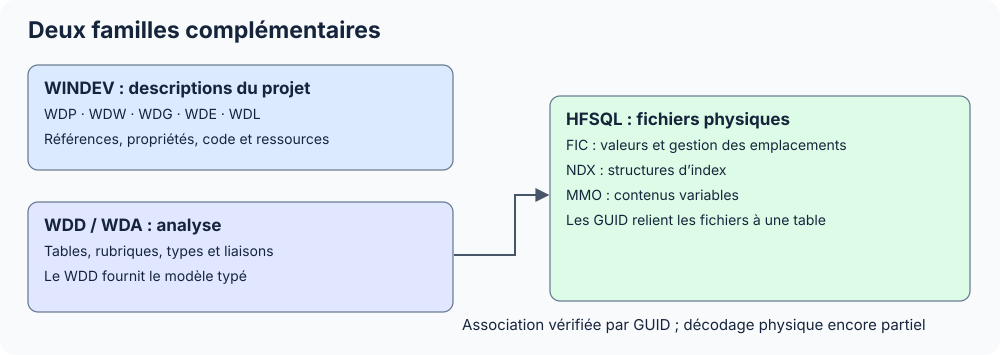

Cette section explique où se trouvent les données dans les fichiers WINDEV et HFSQL, comment les blocs s’emboîtent et quelles parties le lecteur sait interpréter.

Commencer par [lire les offsets et les types](./conventions.mdx), puis choisir une famille. Les tableaux donnent des positions en octets et distinguent les champs confirmés des zones encore opaques.

| Sous-section | Fichiers | Ce qu’on y cherche |
| --- | --- | --- |
| [WINDEV](./windev/index.mdx) | WDP, WDW, WDG, WDD, WDA, WDE, WDL | Projet, interface, code, schéma et ressources compilées |
| [HFSQL](./hfsql/index.mdx) | FIC, NDX, MMO | Emplacements physiques, index, mémos et correspondances avec le schéma |

Pour ouvrir les fichiers en C#, suivre la [Documentation .NET](../dotnet/index.mdx). Pour évaluer la portée des résultats, consulter la [validation et les limites](./validation.mdx).
