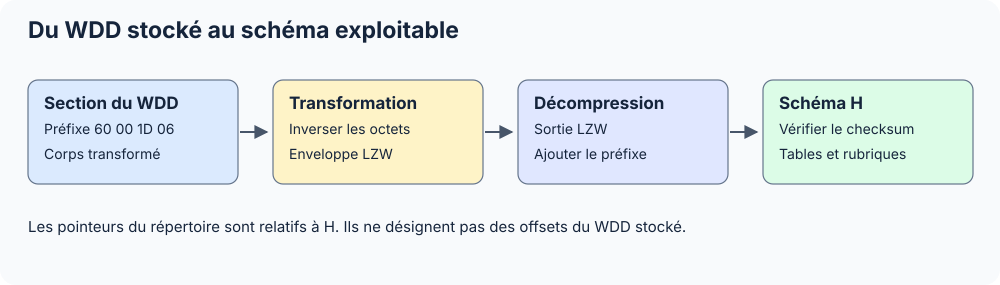

Le WDD décrit les tables, rubriques et liaisons. Il fournit les noms et les types nécessaires pour interpréter des données physiques, mais ne contient pas les lignes des FIC.

Les positions sont exprimées en **octets**. Les inconnues sont indiquées comme telles ; voir les [conventions](../conventions.mdx).

Pour utiliser le lecteur, consulter la [documentation .NET](../../dotnet/index.mdx).



## Variante WINDEV 28 : analyse de PERSONNE

Le nouveau témoin utilise le même en-tête interne `0x0060 / 0x061D`, la même transformation et le même checksum. Les marqueurs de descriptions changent : le lecteur les sélectionne selon la version du conteneur.

| Description | WINDEV 28 | WINDEV 31 | Position du marqueur |
| --- | --- | --- | --- |
| Table | `0x20` | `0x22` | Premier octet de l’enregistrement de table |
| Rubrique | `0x16` | `0x20` | Premier octet de l’enregistrement de rubrique |

Un octet `0x20` n’a donc pas un sens universel. Il faut connaître la version et le répertoire qui conduit à l’enregistrement.

### Carte du WDD 28

| Repère | Offset | Taille | Type / commentaire |
| --- | --- | --- | --- |
| Fichier `F` | 0 | 111 | En-tête et répertoire PCS |
| Section 0 | 111 | 0 | Section vide |
| Section 1 | 111 | 3 316 | Préfixe 4 octets, transformation puis LZW |
| Fin de fichier | 3 427 | 0 | Couverture exacte |
| Sortie LZW | — | 6 483 | À précéder des quatre octets initiaux |
| Schéma `H` reconstruit | 0 | 6 487 | Buffer utilisé pour tous les pointeurs suivants |

| Entrée du répertoire de `H` | Position du pointeur `u64` | Destination | Compte `u32` |
| --- | --- | --- | --- |
| Analyse | 8 | 252 | 1 |
| Tables | 20 | 653 | 2 |
| Liaisons | 32 | 3 652 | 1 |
| Répertoire 3 | 44 | 6 150 | 0 |
| Index des tables | 56 | 6 199 | 2 |
| Répertoire 5 | 68 | 6 375 | 1 |
| Répertoire 6 | 80 | 6 487 | 0 |
| Répertoire 7 | 92 | 6 487 | 0 |

Le rôle du répertoire 5 reste inconnu. Le lecteur n’invente pas une sémantique à partir de son compte non nul.

### Tables, rubriques et longueur physique

Après les six CStrings d’une description de table se trouve une région de 48 octets. Son `u32` à `+12` vaut 124 pour PERSONNE et 33 pour PERSONNE_MESSAGE. L’API le conserve dans `RawRecordByteLength`. La correspondance avec le pas physique est vérifiée pour PERSONNE ; aucun FIC PERSONNE_MESSAGE n’a été fourni.

| Table | Description dans `H` | Position du mot de longueur `u32` | Valeur | Compte de rubriques |
| --- | --- | --- | --- | --- |
| PERSONNE | 653 | 707 | 124 | 5 |
| PERSONNE_MESSAGE | 1 004 | 1 082 | 33 | 3 |

| Table | Rubrique | Description dans `H` | Début du suffixe typé `Q` | Code `u16` à `Q` | Taille déclarée `u16` à `Q+7` | Taille de stockage `u16` à `Q+9` |
| --- | --- | --- | --- | --- | --- | --- |
| PERSONNE | IDPERSONNE | 3 790 | 3 876 | 24 | 8 | 8 |
| PERSONNE | NOM | 4 078 | 4 145 | 2 | 50 | 51 |
| PERSONNE | PRENOM | 4 320 | 4 385 | 2 | 50 | 51 |
| PERSONNE | AGE1 | 4 566 | 4 638 | 5 | 4 | 4 |
| PERSONNE | FLAGADMIN | 4 815 | 4 888 | 37 | 1 | 1 |
| PERSONNE_MESSAGE | IDPERSONNE_MESSAGE | 5 207 | 5 309 | 24 | 8 | 8 |
| PERSONNE_MESSAGE | IDPERSONNE | 5 527 | 5 639 | 25 | 8 | 8 |
| PERSONNE_MESSAGE | TEXTE | 5 829 | 5 892 | 29 | 8 | 8 |

Le code 5 est désormais exposé comme `Int32`. La taille 50 déclarée des textes et le stockage 51 expliquent le NUL supplémentaire observé dans le FIC. Le code 37 de FLAGADMIN confirme que le dernier octet de valeur est un booléen.

Les métadonnées textuelles anonymisées peuvent modifier la taille d’un extrait réécrit ; les offsets du tableau restent ceux du profil binaire étudié, conformément aux [conventions](../conventions.mdx).

### Première liaison non vide

Le WDD relie `PERSONNE.IDPERSONNE` à `PERSONNE_MESSAGE.IDPERSONNE`. Les identifiants sont recoupés avec les descriptions des tables et rubriques ; les contraintes et cardinalités restent en partie brutes.

| Offset dans `H` | Taille | Type | Champ / valeur |
| --- | --- | --- | --- |
| 3 652 | 1 | `u8` | Marqueur 1 |
| 3 653 | 8 | `u64` | Identifiant de liaison : 1 |
| 3 661 | 9 | ASCII Z | Table source : PERSONNE |
| 3 670 | 8 | `u64` | Identifiant de table : 1 |
| 3 678 | 17 | ASCII Z | Table cible : PERSONNE_MESSAGE |
| 3 695 | 8 | `u64` | Identifiant de table : 2 |
| 3 703 | 11 | ASCII Z | Rubrique source : IDPERSONNE |
| 3 714 | 8 | `u64` | Identifiant de rubrique : 1 |
| 3 722 | 11 | ASCII Z | Rubrique cible : IDPERSONNE |
| 3 733 | 8 | `u64` | Identifiant de rubrique : 7 |
| 3 741 | 8 | `u16[4]` | Paramètres bruts : 0, 65 535, 1, 1 |
| 3 749 | 37 | ASCII Z | Nom technique de la contrainte |
| 3 786 | 4 | `u32` brut | 48 ; rôle non attribué |
| 3 790 | 0 | Fin de l’enregistrement | Début de la première rubrique |

`Relations` expose les extrémités, le nom, `RawFlags` et `RawTrailer`. Les valeurs 1 ne sont pas publiées comme des règles de suppression ou des cardinalités validées. Le profil de liaison 28 est le seul profil non vide étudié.


## Référence détaillée du profil WINDEV 31

Les cartes suivantes concernent le corpus initial 31. Les marqueurs 28 sont indiqués dans la comparaison ci-dessus.

## Identification

| Propriété | Valeur |
| --- | --- |
| Extension | `.wdd` |
| Type PCS | `0x00070004` |
| Sections du spécimen | 2 |
| Versions validées | 28, 29 et 31 |
| Variante interne du schéma | `0x0060 / 0x061D` |
| Analyse courante | 6 tables, 37 rubriques, génération 24 |

Le WDD contient la **description du schéma**, pas les enregistrements des fichiers de données `.fic`, `.ndx` ou `.mmo`. Les tailles et types ci-dessous décrivent les métadonnées du schéma ; ils ne constituent pas une spécification du stockage physique de chaque valeur HFSQL.

## Carte du fichier courant

Taille du fichier : 6 164 octets.

| Section | Tag (`u8`) | Début dans le fichier | Longueur (`u32`) | Blocs décodés | Commentaire |
| --- | --- | --- | --- | --- | --- |
| 0 | `0x00` | `0x006F` (111) | 0 | Aucun bloc LZW identifié | Section vide |
| 1 | `0x00` | `0x006F` (111) | 6053 | Transformation puis LZW → 15 821 octets, préfixe compris | Description de schéma transformée, puis compressée |

## De la section stockée au schéma lisible

| Étape | Taille | Position / commentaire |
| --- | --- | --- |
| Section 1 stockée | 6 053 octets | Commence à `F[111]` |
| Préfixe en clair | 4 octets | `60 00 1D 06` |
| Région transformée | 6 049 octets | Tout ce qui suit le préfixe dans la section |
| Enveloppe après transformation | 6 049 octets | Méthode 04 à +4 de la section |
| Flux LZW | 6 038 octets | À +15 de la section après transformation |
| Sortie LZW | 15 817 octets | Débute par le somme de contrôle, sans les quatre octets initiaux |
| Schéma reconstruit `H` | 15 821 octets | Préfixe original de 4 octets + sortie LZW |

La [transformation héritée](./transformation-wdd.mdx) doit être appliquée avant le LZW. Les pointeurs du schéma s'appliquent à `H` ; ajouter leurs valeurs au début du fichier serait incorrect.

## Premier en-tête du schéma reconstruit

| Offset dans `H` | Taille | Type | Champ / commentaire |
| --- | --- | --- | --- |
| `0x0000` / 0 | 2 | `u16` | Mot 96 (`0x0060`) ; cette taille correspond au premier répertoire de huit entrées |
| `0x0002` / 2 | 2 | `u16` | Variante interne `0x061D`, soit 1 565 |
| `0x0004` / 4 | 4 | `u32` | Somme de contrôle de la région commençant à +8 |
| `[8, 104)` | 96 | 8 couples `u64 + u32` | Premier répertoire |
| `[104, 252)` dans le spécimen | 148 | `octets[148]` | Autres données d'en-tête ; sémantique non entièrement interprétée |
| À la position donnée par le répertoire 0 | Variable | Enregistrement d'analyse | Commence à 252 dans le spécimen |

Le début des métadonnées ne doit pas être supposé toujours égal à 252 : sa position est lue dans le premier couple du répertoire.

## Répertoire de huit entrées

Pour l'entrée `i` :

| Offset dans `H` | Taille | Type | Champ |
| --- | --- | --- | --- |
| `8 + 12 × i` | 8 | `u64` | Position dans `H` |
| `16 + 12 × i` | 4 | `u32` | Nombre d'éléments annoncé |

Valeurs du WDD courant :

| Entrée | Position du couple | Pointeur dans `H` | Compte (`u32`) | Commentaire |
| --- | --- | --- | --- | --- |
| 0 | `0x0008` (8) | `0x00FC` (252) | 1 | Métadonnées de l’analyse |
| 1 | `0x0014` (20) | `0x029F` (671) | 6 | Descriptions de tables |
| 2 | `0x0020` (32) | `0x0BD5` (3029) | 0 | Répertoire des liaisons ; zéro dans ce spécimen 31 |
| 3 | `0x002C` (44) | `0x3B7F` (15231) | 0 | Rôle inconnu |
| 4 | `0x0038` (56) | `0x3BB0` (15280) | 6 | Index des noms de tables |
| 5 | `0x0044` (68) | `0x3DCD` (15821) | 0 | Rôle inconnu |
| 6 | `0x0050` (80) | `0x3DCD` (15821) | 0 | Rôle inconnu |
| 7 | `0x005C` (92) | `0x3DCD` (15821) | 0 | Rôle inconnu |

Un compte nul peut être associé à un pointeur égal à la fin du buffer ou à une position partagée avec une autre région. Il ne justifie pas de lire un enregistrement à cette position.

Dans le corpus initial 31, l’entrée 2 a toujours un compte nul. Le nouveau WDD 28 contient une liaison non vide, décrite plus bas ; il confirme le rôle de ce répertoire pour ce profil.

## Somme de contrôle

```text
somme = 0
p = 8
pendant qu'il reste au moins quatre octets :
    somme = (somme + lire_u32(H, p)) modulo 2^32
    p = p + 4
pour chaque octet restant :
    somme = (somme + H[p]) modulo 2^32
exiger somme = lire_u32(H, 4)
```

Exemple arithmétique fictif, indépendant de la carte du WDD : une région à sommer contenant `04 03 02 01 FE FF FF FF 07 08` produit les valeurs suivantes.

| Étape | Valeur / type |
| --- | --- |
| Premier mot | `0x01020304`, `u32` |
| Deuxième mot | `0xFFFFFFFE`, `u32` |
| Deux octets restants | 7 et 8, deux `u8` |
| Somme modulo `2^32` | `0x01020311` |
| Octets de cette somme dans un champ `u32` | `11 03 02 01` |

Pour un WDD concret, la somme stockée est à `H[4]` et doit être comparée au résultat calculé sur la totalité de `H[8..fin]`. Une modification d’un nom ou d’un GUID impose de la recalculer.

Ce contrôle fournit une validation indépendante du fait de retrouver quelques noms lisibles dans la sortie.

## Enregistrement des métadonnées d'analyse

Soit `A` la position donnée par l'entrée 0 :

| Position | Taille | Type | Champ / commentaire |
| --- | --- | --- | --- |
| `A + 0` | 1 | `u8` | Tag 05 |
| `A + 1` | Variable | `CString` | Nom du WDD |
| Juste après | Variable | `CString` | Répertoire d'origine |
| Juste après | Variable | `CString` | Métadonnée auxiliaire vide dans le spécimen ; rôle exact non établi |
| Juste après | Variable | `CString` | GUID textuel de l'analyse |
| Juste après le GUID | 4 | `u32` | Génération de l'analyse |
| Reste de l'enregistrement | Variable | `octets[n]` | Autres paramètres non entièrement décodés |

Exemple fictif : `SuperNoteExtra.wdd`, GUID `54077D9E89F753879ECE3503D29F691E`, génération 24. Le GUID mesure 33 octets avec son NUL.

## Index des noms de tables

L'entrée de répertoire 4, dont le couple commence à +56, pointe sur une liste :

| Position relative à une entrée d'index | Taille | Type | Champ |
| --- | --- | --- | --- |
| `+0` | Variable `Z_n` | `CString` | Nom logique de table |
| `+Z_n` | 8 | `u64` | Position de la description de table dans `H` |

```text
taille_entree_index_table = Z_n + 8
```

Le compte de cet index, à `H[64]`, est comparé au compte de tables à `H[28]`. Les deux valent 6 dans le WDD courant.

## Description d'une table

Soit `T` le début de la description :

| Offset relatif à `T` | Taille | Type | Champ / commentaire |
| --- | --- | --- | --- |
| `+0` | 1 | `u8` | Tag 22 en hexadécimal |
| `+1` | 4 | `u32` | Identifiant interne de table |
| `+5` | 4 | `octets[4]` | Région auxiliaire ; zéros dans les exemples |
| `+9` | Variable | `CString` | Nom logique |
| Après le nom | Variable | `CString` | Nom physique |
| Ensuite | Variable | `CString` | Répertoire |
| Ensuite | Variable | `CString` | Libellé de table |
| Ensuite | Variable | `CString` | Métadonnée auxiliaire ; vide dans les spécimens détaillés |
| Ensuite | Variable | `CString` | Extension du fichier physique, `fic` dans le corpus |

Soit `P_6` le curseur juste après ces six chaînes. La suite est :

| Offset / curseur | Taille | Type | Champ / commentaire |
| --- | --- | --- | --- |
| `P_6` | 48 | `octets[48]` | Paramètres fixes, non entièrement interprétés |
| `P_6 + 48` | Variable | `CString` | GUID textuel de la table |
| Juste après | Variable | `CString` | GUID textuel de l'analyse |
| Juste après | 2 | `octets[2]` | Données auxiliaires |
| Ensuite, curseur nommé `N` | Variable `Z_r` | `CString` | Nom secondaire du record ; rôle exact non confirmé |
| Ensuite | 2 | `octets[2]` | Données auxiliaires |
| Ensuite, curseur nommé `P` | Variable | Répertoires internes | Carte ci-dessous |

Le nom initial doit concorder exactement avec celui de l’index. La chaîne à `N` est identique au nom logique dans les témoins étudiés, mais cette observation ne démontre pas une contrainte du format. Elle est conservée dans `RawRecordName`, avec sa position `RawRecordNameOffset` dans `H`. Le lecteur ne l’utilise ni pour identifier la table, ni pour retrouver ses rubriques.

```text
P = N + Z_r + 2
Z_r = longueur en octets de la chaîne secondaire, NUL final compris
```

Depuis la version 0.12.1, une différence produit le diagnostic `TableRecordNameMismatch` après validation du schéma. Elle ne bloque plus l’ouverture à elle seule. La chaîne peut être vide ou de longueur différente ; le curseur suit sa terminaison NUL, sans recherche de nom dans les octets voisins. Son rôle exact reste inconnu : aucun sens d’alias, de nom physique ou de connexion ne lui est attribué.

Le checksum, l’accord des deux noms logiques, les comptes de répertoire, les bornes des pointeurs, les tags des rubriques et leur appartenance à la table restent vérifiés. Une divergence de cette chaîne accompagnée d’un répertoire invalide reste donc une erreur.

L’ancien message `WDD table record name mismatch (offset …)` désignait le curseur `P`, après la chaîne et les deux octets auxiliaires. Cet offset appartient au schéma décodé `H`, préfixe de quatre octets compris ; ce n’est pas une position directe dans le WDD stocké. Le nouveau diagnostic donne le début `N` de la chaîne secondaire et n’inclut aucun nom de table.

La correction a été vérifiée avec des variantes synthétiques des témoins 29 et 31 : l’ancien lecteur les refuse, le nouveau conserve les tables et rubriques. Des records déplacés testent également une chaîne vide et une chaîne UTF-8 plus longue. Ces essais ne déterminent pas la signification de la chaîne et ne certifient pas les analyses privées ayant motivé le signalement.

## Répertoires internes de rubriques

La position `P` dépend des longueurs des chaînes précédentes :

| Offset relatif à `P` | Taille | Type | Champ / commentaire |
| --- | --- | --- | --- |
| `+0` | 8 | `u64` | Début annoncé de la région de rubriques |
| `+8` | 4 | `u32` | Nombre de rubriques |
| `[+12, +70)` | 58 | `octets[58]` | Autres paramètres et sous-répertoires non entièrement interprétés |
| `+70` | 8 | `u64` | Position de l'index des rubriques utilisé par le lecteur |
| `+78` | 4 | `u32` | Nombre d'entrées de cet index |
| À partir de `+82` | Variable | `octets[n]` | Autres index et données de table, non entièrement interprétés |

Les nombres à `P + 8` et `P + 78` doivent être identiques.

### Index des rubriques

Soit `I` sa position :

| Position | Taille | Type | Champ / commentaire |
| --- | --- | --- | --- |
| `I + 0` | 4 | `octets[4]` | Préfixe brut, nul dans les exemples |
| `I + 4 + 12 × j` | 8 | `u64` | Position exacte de la rubrique `j` dans `H` |
| `I + 12 + 12 × j` | 4 | `u32` brut | Identifiant/numéro d'entrée observé ; sens global non établi |

Le lecteur suit ces pointeurs, au lieu de rechercher les noms dans le binaire ou d'estimer la taille des descriptions.

## Description d'une rubrique

Soit `R` le début de la description :

| Offset relatif à `R` | Taille | Type | Champ / commentaire |
| --- | --- | --- | --- |
| `+0` | 1 | `u8` | Tag 20 en hexadécimal |
| `+1` | 4 | `u32` | Identifiant interne de rubrique |
| `+5` | 4 | `octets[4]` | Région auxiliaire |
| `+9` | 4 | `u32` | Identifiant de la table propriétaire |
| `+13` | 4 | `octets[4]` | Région auxiliaire |
| `+17` | Variable | `CString` | Nom de la rubrique |
| Juste après | Variable | `CString` | Libellé |
| Juste après | Variable | `CString` | GUID textuel |
| Juste après | Variable | `CString` | Masque de saisie |

Soit `Q` le curseur juste après le masque :

| Offset relatif à `Q` | Taille | Type | Champ / commentaire |
| --- | --- | --- | --- |
| `+0` | 2 | `u16` | Code de type interne |
| `+2` | 4 | `u32` | Flags bruts |
| `+6` | 1 | `u8` brut | Octet auxiliaire, nul dans les exemples |
| `+7` | 2 | `u16` | Taille déclarée dans le schéma |
| `+9` | 2 | `u16` | Autre taille, exposée comme taille de stockage par le lecteur ; unité exacte dépendante du type |
| `[+11, +23)` | 12 | `octets[12]` | Métadonnées non interprétées |
| `+23` | 2 | `u16` brut | Premier ordinal observé ; contrôlé lors de la résolution des composants |
| `+25` | 2 | `u16` brut | Second ordinal observé ; même valeur dans les profils de clés composées validés |
| `+27` | 2 | `u16` LE | Nature de clé : 0 non-clé, 2 doublons, 4 primaire dans les profils 28/31 vérifiés |
| `+29` | 2 | `u16` brut | Valeur 1 dans le témoin ; rôle non établi |
| `+31` | 1 | `u8` | Marqueur de clé composée ; le lecteur exige aussi le type 28 |
| Après `+32` | Variable | `octets[n]` | Défauts et autres propriétés ; le profil composé possède un pointeur détaillé plus bas |

L'identifiant de table à `R + 9` doit correspondre à la table dont l'index a fourni la rubrique.

## Codes de type rencontrés

| Code binaire (`u16`) | Hexadécimal | Type métier retenu | Code public de référence dans `analysis.json` | Taille du spécimen |
| --- | --- | --- | --- | --- |
| 2 | `0002` | Texte | 2 | 50, 100 ou 200 |
| 11 | `000B` | Heure | 11 | 4 |
| 14 | `000E` | Date | 14 | 8 |
| 24 | `0018` | Identifiant automatique sur 64 bits | 1 | 8 |
| 25 | `0019` | Entier signé sur 64 bits | 19 | 8 |
| 26 | `001A` | Entier non signé sur 32 bits, dans les rubriques testées | 22 | 4 |
| 27 | `001B` | Entier non signé sur 64 bits | 20 | 8 |
| 28 | `001C` | Binaire ; clé composée lorsque le marqueur à Q+31 vaut 1 dans le profil observé | 23 | 2 ou 50 |
| 29 | `001D` | Mémo texte | 15 | 8 |
| 34 | `0022` | Date-heure | 24 | 8 |
| 36 | `0024` | Entier non signé sur 8 bits | 12 | 1 |
| 37 | `0025` | Booléen | 27 | 1 |

Le code interne et le code public ne sont pas interchangeables. Une taille 8 d'un mémo texte ne signifie pas que son texte est limité à huit caractères. Cette documentation ne déduit pas le format physique des valeurs de la seule taille déclarée.

## Positions des tables et index dans le WDD courant

| ID (`u32`) | Table | Début dans `H` | Nom physique | Rubriques | Curseur `P` | Index des rubriques `I` |
| --- | --- | --- | --- | --- | --- | --- |
| 1 | ENTREE_JOURNAL | `0x029F` (671) | entree_journal | 14 | `0x0360` (864) | `0x1D25` (7461) |
| 2 | JOUR_FERIE | `0x0427` (1063) | jour_ferie | 5 | `0x04D8` (1240) | `0x2419` (9241) |
| 3 | SEMAINE_COURS | `0x0597` (1431) | semaine_cours | 3 | `0x0654` (1620) | `0x281D` (10269) |
| 4 | ENTREE_JOURNAL_DOC_JOINT | `0x0719` (1817) | entree_journal_doc_joint | 8 | `0x0802` (2050) | `0x321E` (12830) |
| 5 | PROJET | `0x08DD` (2269) | projet | 4 | `0x097E` (2430) | `0x374E` (14158) |
| 6 | ENTREE_COFFRE_FORT | `0x0A35` (2613) | entree_coffre_fort | 3 | `0x0B06` (2822) | `0x3B30` (15152) |

## Exemple : première table et première rubrique

| Champ | Position dans `H` | Valeur |
| --- | --- | --- |
| Début de table ENTREE_JOURNAL | 671 / `0x029F` | Tag 22 |
| Identifiant de table | 672 | 1 |
| Premier nom logique | 680 | `ENTREE_JOURNAL` |
| Segment fixe de 48 octets | 731 | Données non entièrement interprétées |
| GUID de table | 779 | `74D77310387B5AC2AED6DB363F282DD5` |
| Curseur `P` | 864 | Pointeur de première rubrique et comptes |
| Première rubrique | 3 029 / `0x0BD5` | `IDENTREE_JOURNAL`, tag 20 |
| Index des rubriques | 7 461 / `0x1D25` | 14 entrées |

La carte détaillée des 37 rubriques est donnée dans l'[annexe des valeurs](./exemples-schema.mdx).

## Relations du corpus initial et propriétés partielles

Les WDD 31 du corpus initial annoncent zéro liaison. Le supplément 28 ci-dessus apporte la première liaison non vide décodée, avec des propriétés de contrainte encore brutes.

Les natures de clé 0/2/4 et les composants ordonnés des profils 28/31 sont interprétés comme décrit ci-dessous. Les autres codes de clé, contraintes, valeurs par défaut, connexions, encodages protégés et autres flags ne sont pas entièrement interprétés. Les flags sont exposés comme `u32` brut, sans nommer chaque bit d'après une simple corrélation de valeurs.

## Fichiers physiques et protection

Les GUID lient une description à ses fichiers physiques. Le WDD applicatif fourni n’a pas le GUID d’analyse commun aux tables RAD. Aucun mot de passe utilisable sur ces fichiers n’a été extrait de cette analyse. Voir le [chapitre de protection HFSQL](../hfsql/protection.mdx).


## Une taille du schéma n’est pas toujours une zone de valeur FIC

Le type 28 avec le marqueur à `Q+31` égal à 1 de MOISJOUR est maintenant recoupé avec une clé composée NDX. Cette rubrique n’ajoute pas quatre octets au FIC : le pas JOUR_FERIE reste 70. L’API expose `RawCompositeMarker` et `IsCompositeKey` pour ce profil vérifié, et `Type` vaut `CompositeKey` au lieu du libellé binaire générique antérieur. Les autres tuples restent bruts ou conservent leur interprétation antérieure. Voir les [clés NDX](../hfsql/ndx.mdx) et la comparaison des marqueurs ci-dessous.

## WDD : marqueurs propres à la version 29

La section 0 est vide à 111 ; la section 1 commence à 111 et mesure 1 208 octets. La transformation héritée et le LZW existants produisent un schéma `H` de **2 287 octets**, checksum vérifié. Sa variante interne reste `0x0060 / 0x061D`.

| Élément | Offset dans `H` | Type / valeur |
| --- | --- | --- |
| Métadonnées d’analyse | 252 | Génération 1 |
| Table PERSONNE | 662 | Marqueur `u8 = 0x21` |
| Longueur brute d’emplacement | 716 | `u32 = 127` |
| Index des noms de tables | 2 203 | Une entrée |
| Répertoire de rubriques | 2 049 | Quatre entrées |
| Répertoire des liaisons | 1 014 | Compte nul ; pas de liaison non vide validée en 29 |

| Rubrique | Description dans `H` | Marqueur `u8` | Suffixe typé `Q` | Code `u16` à `Q` | Déclaré `u16` à `Q+7` | Stockage `u16` à `Q+9` |
| --- | --- | --- | --- | --- | --- | --- |
| IDPERSONNE | 1 014 | `0x17` | 1 100 | 24 | 8 | 8 |
| NOM | 1 303 | `0x17` | 1 371 | 2 | 50 | 51 |
| PRENOM | 1 547 | `0x17` | 1 621 | 2 | 50 | 51 |
| DESC | 1 803 | `0x17` | 1 871 | 29 | 8 | 8 |

Le code de rubrique **29** de DESC indique un mémo texte ; ce nombre n’est pas la version WINDEV. Ses huit octets sont une référence de mémo, pas une chaîne de huit caractères.

## Clé composée et rubrique binaire

Le profil WDD de MOISJOUR est `RawTypeCode = 28`, `RawFlags = 0x1C`, `Size = 2`, `StorageSize = 4`. Son suffixe typé commence à `H[9028]` ; l’octet à **Q+31**, donc `H[9059]`, vaut 1. Il est exposé comme `RawCompositeMarker`. La rubrique binaire HASH du même schéma porte aussi le code 28 et les flags 0x1C, mais cet octet vaut 0 : les flags seuls ne distinguent donc pas ces deux cas.

`IsCompositeKey` exige le type 28 et ce marqueur à 1 ; le libellé devient `CompositeKey`. L’association du marqueur est recoupée sur MOISJOUR et reste une interprétation du profil étudié. Les autres rubriques binaires conservent leur type. Les composants et leur ordre sont désormais reconstruits depuis le WDD 28/31 ; l’ordre MOIS puis JOUR reste recoupé indépendamment avec le NDX. Le parcours du vecteur est décrit ci-dessous.

## Profil de schéma observé en version 25

Le WDD fourni mesure **1 317 octets**. Deux sections commencent à `F[111]` : la section 0 est vide et la section 1 mesure **1 206 octets**. La transformation héritée puis le LZW produisent un schéma `H` de **2 171 octets** ; le checksum est vérifié. Les mots de révision interne restent `0x0060` et `0x061D`. Le LZW fournit 2 167 octets, auxquels s’ajoute le préfixe de quatre octets conservé dans `H`.

### Comparaison des marqueurs

| Structure | Type | Version 15 | Version 24 | Version 25 | Version 28 | Version 29 | Version 31 |
| --- | --- | --- | --- | --- | --- | --- | --- |
| Enregistrement de table | `u8` à son début | `0x12` | `0x19` | `0x19` | `0x20` | `0x21` | `0x22` |
| Enregistrement de rubrique | `u8` à son début | `0x10` | `0x15` | `0x15` | `0x16` | `0x17` | `0x20` |

Ces octets sont des marqueurs de structure, pas les versions majeures. Aucune formule d’incrémentation ne permet de certifier les versions 26, 27 ou 30 ; le lecteur sélectionne explicitement les profils observés.

| Élément | Offset dans `H` | Type / valeur |
| --- | --- | --- |
| Racine de l’analyse | 252 | Tag `u8 = 5`, génération 1 après les chaînes |
| Table PERSONNE | 662 | Tag `u8 = 0x19` |
| Longueur d’emplacement | 716 | `u32` LE = 127 |
| Répertoire des liaisons | 1 012 | Compte 0 ; aucune liaison non vide validée en 25 |
| Répertoire des rubriques | 1 933 | Quatre entrées, précédées de quatre octets |
| Index des noms de tables | 2 087 | Une entrée |
| Fin exclusive | 2 171 | Fin du schéma décodé |

| Rubrique | Début dans `H` | Tag `u8` | Suffixe typé `Q` | Type `u16` à Q | Taille `u16` à Q+7 | Stockage `u16` à Q+9 |
| --- | --- | --- | --- | --- | --- | --- |
| IDPERSONNE | 1 012 | `0x15` | 1 098 | 24 | 8 | 8 |
| NOM | 1 268 | `0x15` | 1 342 | 2 | 50 | 51 |
| PRENOM | 1 485 | `0x15` | 1 565 | 2 | 50 | 51 |
| DESC | 1 714 | `0x15` | 1 788 | 29 | 8 | 8 |

Le lecteur retrouve les descriptions par les pointeurs du répertoire, puis lit les chaînes de longueur variable avant le suffixe typé. Il ne réutilise pas les offsets absolus du témoin 29. Le type 29 de DESC désigne le mémo texte, indépendamment de la version WINDEV ; ses huit octets de stockage contiennent ici une référence vers le MMO. L’identité des fichiers physiques est contrôlée avec les deux GUID, qui ne sont pas publiés dans les exemples.

## Profil de schéma observé en version 24

Le WDD 24 mesure **1 305 octets** : la section 0 est vide à 111 ; la section 1 commence à 111 et mesure **1 194 octets**. La transformation héritée et le LZW déjà reconnus produisent `H`, un schéma de **2 153 octets**, préfixe de quatre octets inclus. La somme de contrôle est vérifiée ; la révision interne reste `0x0060 / 0x061D`.

| Élément | Offset dans H | Type / valeur |
| --- | --- | --- |
| Racine d’analyse | 252 | Tag `u8 = 5`, génération 1 après les chaînes |
| Table PERSONNE | 662 | Tag `u8 = 0x19`, comme le témoin 25 |
| Taille d’emplacement | 716 | `u32` LE = 127 |
| Répertoire de liaisons | 1 012 | Compte 0 ; aucune liaison non vide validée en 24 |
| Répertoire de rubriques | 1 915 | Quatre entrées de 12 octets, après quatre octets de préfixe |
| Index des noms de tables | 2 069 | Une entrée |
| Fin exclusive | 2 153 | Fin du schéma |

| Ordre du répertoire | Rubrique | Début dans H | Tag `u8` | Suffixe Q | Code `u16` à Q | Taille `u16` à Q+7 | Stockage `u16` à Q+9 |
| --- | --- | --- | --- | --- | --- | --- | --- |
| 0 | IDPERSONNE | 1 012 | `0x15` | 1 098 | 24 | 8 | 8 |
| 1 | PRENOM | 1 268 | `0x15` | 1 342 | 2 | 50 | 51 |
| 2 | NOM | 1 491 | `0x15` | 1 559 | 2 | 50 | 51 |
| 3 | DESC | 1 702 | `0x15` | 1 770 | 29 | 8 | 8 |

**PRENOM précède NOM dans ce schéma**, contrairement aux témoins 25/29. C’est une différence de contenu observée, pas une règle de tri propre à WINDEV 24. Le lecteur conserve l’ordre du répertoire et ne trie pas les rubriques par nom. La correspondance avec les champs physiques dépend de cet ordre et des deux GUID, jamais du seul nom PERSONNE.

Les marqueurs de table `0x19` et de rubrique `0x15` sont les mêmes qu’en 25. La différence de longueur et les nouveaux offsets ne demandent aucun nouveau codec. Les GUID et libellés applicatifs privés sont remplacés dans la documentation ; les tableaux gardent les positions mesurées.

## Profil de schéma observé en version 15

Le WDD 15 mesure **1 279 octets**. Sa section 0 est vide à 111 ; sa section 1 commence à 111 et mesure **1 168 octets**. La transformation héritée et le LZW reconnus produisent un schéma H de **1 892 octets** : quatre octets de préfixe conservés et **1 888 octets décompressés**. La révision interne reste `0x0060 / 0x061D` et la somme de contrôle est vérifiée.

### Marqueurs et répertoires

| Élément | Offset dans H | Taille / type | Valeur ou structure |
| --- | --- | --- | --- |
| Première entrée de répertoire | 8 | `u64` + `u32` | Pointeur racine 192, compte 1 |
| Racine d’analyse | 192 | `u8` puis CString | **Tag 4**, contre 5 dans les témoins récents |
| Génération | 272 | `u32` LE | 1 après les quatre chaînes de la racine |
| Table PERSONNE | 586 | `u8` | **Tag `0x12`** |
| Segment fixe après les six chaînes de table | 628 | 48 octets | Métadonnées de table |
| Taille d’emplacement | 640 = 628+12 | `u32` LE | **123** |
| Répertoire de liaisons | 900 | Pointeur du répertoire, compte 0 | Aucune liaison non vide validée en 15 |
| Répertoire de rubriques | 1 666 | Préfixe 4 + quatre entrées de 12 | Pointeurs vers les descriptions |
| Index des noms de tables | 1 808 | CString + pointeur `u64` | Une table |
| Fin exclusive | 1 892 | — | Fin du schéma reconstruit |

La racine à **192**, au lieu de 252 dans les témoins récents, ne doit pas être remplacée par une constante dans le lecteur. Le pointeur `u64` à H+8 fait foi. Les GUID applicatifs ne sont pas publiés ; leur égalité est vérifiée entre l’analyse et les trois fichiers physiques.

### Rubriques et identifiant de quatre octets

| Rubrique | Début dans H | Tag `u8` | Suffixe Q | Code `u16` à Q | Taille `u16` à Q+7 | Stockage `u16` à Q+9 |
| --- | --- | --- | --- | --- | --- | --- |
| IDPERSONNE | 900 | `0x10` | 986 | **38 (`0x26`)** | **4** | **4** |
| NOM | 1 118 | `0x10` | 1 192 | 2 | 50 | 51 |
| PRENOM | 1 297 | `0x10` | 1 377 | 2 | 50 | 51 |
| DESC | 1 488 | `0x10` | 1 559 | 29 | 8 | 8 |

Le code **38** est exposé comme `AutomaticIdentifier32`, avec une largeur de stockage de quatre octets. Le code 24 des identifiants de huit octets des autres témoins n’est pas réutilisé par approximation. La disposition FIC choisit une lecture explicite `Int32` de ce profil ; l’unique valeur positive 1 ne suffit pas à démontrer le domaine numérique complet du moteur.

L’ordre est NOM puis PRENOM et les valeurs sont conservées sous ces noms, même si leur signification humaine semble inversée. Le type 29 de DESC reste une référence de mémo de huit octets. Les marqueurs `0x10` des rubriques et `0x10` des événements source appartiennent à des structures différentes : un octet seul n’identifie pas une famille globale d’enregistrement.


## Nature des clés et composition : profils 28 et 31

Le type d’une rubrique et sa nature de clé sont deux informations distinctes. Un identifiant automatique ne suffit pas à conclure « clé primaire », et un entier de huit octets non signé peut être non clé. La comparaison différentielle du WDD 28 de PERSONNE isole la nature de clé au mot **`u16(Q + 27)`** ; `RawFlags`, lu à `Q + 2`, reste une autre propriété.

### Codes vérifiés

| Mot `u16` LE à `Q + 27` | Interprétation | API | Vérification |
| --- | --- | --- | --- |
| 0 | Non-clé | `WindevKeyKind.None` | NOM, PRENOM et IDPERSONNEPASCLE décrits comme non-clés |
| 2 | Clé acceptant les doublons | `WindevKeyKind.Duplicates` | AGE1, FLAGADMIN et NOMPRENOMAGE1 ; recoupement JOUR/MOIS/MOISJOUR en 31 |
| 4 | Clé primaire | `WindevKeyKind.Primary` | IDPERSONNE décrit comme primaire ; même code sur l’identifiant de JOUR_FERIE en 31 |
| 1 ou autre valeur | Sens non confirmé par un témoin explicite dans cette étude | `KeyKind == null` | Le mot reste disponible dans `Key.RawKind` |

Le code 1 est présent dans la seconde table du WDD. Il n’est pas automatiquement classé comme clé unique ou primaire à partir du type d’identifiant ou de son nom. Les codes ne sont pas traités comme un jeu de bits : aucune signification n’est déduite pour 3, 5 ou une autre combinaison.

Une clé primaire n’accepte pas les doublons ; `AllowsDuplicates` vaut donc faux pour le code 4 et vrai pour le code 2. Pour une non-clé, cette propriété vaut `null` : il n’y a pas de politique de doublons d’index à décrire. Cela ne constitue pas un décodage indépendant des contraintes de nullité, de suppression ou de modification.

La [documentation fonctionnelle de PC SOFT sur les prérequis de réplication](https://doc.windev.com/en-US/?1000020587=) distingue l’identifiant automatique et la clé primaire. Elle ne donne pas le codage du WDD ; les positions et les codes ci-dessus proviennent des fichiers étudiés.

### Carte du nouveau témoin 28

Le fichier mesure **3 676 octets**. La section 0 est vide à 111, puis la section 1 couvre `[111, 3676)`, soit 3 565 octets. La transformation héritée et le LZW produisent **7 148 octets dans `H`**, préfixe de révision inclus ; la somme de contrôle est vérifiée.

| Élément | Position dans `H` | Type / valeur |
| --- | --- | --- |
| Description d’analyse | 252 | Tag 5 ; métadonnées de l’analyse |
| Table PERSONNE | 653 | Tag `0x20` ; pas brut déclaré 132 octets |
| Table PERSONNE_MESSAGE | 1004 | Tag `0x20` ; pas déclaré 33 octets |
| Liaison | 3652 | Une liaison ; extrémités décodées avec le lecteur existant |
| Répertoire PERSONNE | 5685 | Sept entrées de rubrique |
| Répertoire PERSONNE_MESSAGE | 6732 | Trois entrées |
| Index des noms de tables | 6860 | Deux entrées |

Le WDD antérieur de PERSONNE reste un autre témoin : cinq rubriques et un pas de 124 octets. Il n’est pas remplacé dans les tests par cette nouvelle révision.

| Rubrique PERSONNE | Début de description | Suffixe `Q` | Type `u16(Q)` | Flags `u32(Q+2)` | Taille déclarée / stockage | Nature de clé : position / valeur |
| --- | --- | --- | --- | --- | --- | --- |
| IDPERSONNE | 3790 | 3876 | 24 : identifiant automatique 64 bits | `0x09` | 8 / 8 | 3903 / 4 : primaire |
| NOM | 4078 | 4145 | 2 : texte | `0x12` | 50 / 51 | 4172 / 0 : non-clé |
| PRENOM | 4320 | 4385 | 2 : texte | `0x12` | 50 / 51 | 4412 / 0 : non-clé |
| AGE1 | 4566 | 4638 | 5 : entier signé 32 bits | `0x08` | 4 / 4 | 4665 / 2 : doublons |
| FLAGADMIN | 4815 | 4888 | 37 : booléen | `0x01` | 1 / 1 | 4915 / 2 : doublons |
| IDPERSONNEPASCLE | 5076 | 5186 | 27 : entier non signé 64 bits | `0x05` | 8 / 8 | 5213 / 0 : non-clé |
| NOMPRENOMAGE1 | 5388 | 5473 | 28 + marqueur composé 1 | `0x1C` | 104 / 106 | 5500 / 2 : doublons |

Les textes de 50 octets gardent ici une taille de stockage de 51, incluant leur terminaison observée. Le type 27 est exposé comme `UInt64` ; il est distinct du type 24 d’identifiant automatique.

### Vecteur des composants

Pour les clés composées de type 28 avec `RawCompositeMarker == 1`, le profil vérifié porte un pointeur à **`Q + 46`**. Il est lu comme un `u64` LE et désigne une position absolue dans `H`, sans ajouter le début de la section compressée.

| Position | Taille | Type de lecture | Sens retenu |
| --- | --- | --- | --- |
| `Q + 31` | 1 | `u8` | Marqueur composé égal à 1 |
| `Q + 46` | 8 | `u64` LE | Position `P` du vecteur dans `H` |
| `P + 0` | 2 | `u16` LE | Nombre `n` de composants |
| `P + 2 + 3 × j` | 2 | Vue `u16` LE | Ordinal local de la rubrique composante |
| `P + 4 + 3 × j` | 1 | `u8` brut | Options du composant, sans direction de tri déduite |
| Fin du vecteur | — | — | `P + 2 + 3 × n` |

La lecture de `Q + 46` est limitée au profil composé reconnu. À cet endroit d’une rubrique ordinaire, d’autres valeurs et des textes par défaut peuvent se trouver : il ne faut pas appliquer ce pointeur à toutes les rubriques.

Les références observées sont des ordinaux locaux, pas les identifiants internes de rubrique. Dans les témoins validés, elles correspondent à l’ordre du répertoire de la table et aux mots stockés à `Q + 23` et `Q + 25` des rubriques référencées. Le lecteur vérifie cette correspondance. Si ces ordinaux divergent, la résolution est refusée comme variante non validée plutôt que de retourner un nom supposé.

Les indices observés tiennent tous dans un octet, avec un second octet nul. La vue retenue est `u16` pour l’ordinal, puis un octet d’options ; le domaine des grandes valeurs et la signification des options non nulles ne sont pas certifiés par ces témoins.

### NOMPRENOMAGE1 : détail octet par octet

Le suffixe commence à `Q = 5473`. Le marqueur est à 5504 et le pointeur `u64` à **5519 = Q + 46** vaut **5674**.

| Position dans `H` | Taille | Type | Valeur | Résolution |
| --- | --- | --- | --- | --- |
| 5674 | 2 | `u16` LE | 3 | Trois composants |
| 5676 | 2 | Ordinal `u16` | 1 | NOM : identifiant interne 2 |
| 5678 | 1 | Options `u8` | 0 | Sens détaillé non attribué |
| 5679 | 2 | Ordinal `u16` | 2 | PRENOM : identifiant interne 3 |
| 5681 | 1 | Options `u8` | 0 | Sens détaillé non attribué |
| 5682 | 2 | Ordinal `u16` | 3 | AGE1 : identifiant interne 4 |
| 5684 | 1 | Options `u8` | 0 | Sens détaillé non attribué |
| 5685 | — | Fin exclusive | `5674 + 2 + 3 × 3` | Correspond au début du répertoire de rubriques dans ce témoin |

L’ordre vient du vecteur. Le lecteur ne découpe ni le nom `NOMPRENOMAGE1` ni son libellé pour fabriquer une liste de composants. Un test modifie les ordinaux sans changer ces textes : la liste retournée suit bien les nouveaux ordinaux.

### Recoupement MOISJOUR en version 31

Dans le WDD 31, MOISJOUR garde son suffixe à 9028 et son marqueur à 9059. Le mot de nature de clé à **9055 = Q + 27** vaut 2. Le pointeur à **9074 = Q + 46** vaut **9233**.

| Position | Taille | Type | Valeur / composant |
| --- | --- | --- | --- |
| 9233 | 2 | `u16` LE | 2 composants |
| 9235 | 2 | Ordinal `u16` | 2 : MOIS, identifiant interne 9 |
| 9237 | 1 | Options `u8` | 0 |
| 9238 | 2 | Ordinal `u16` | 1 : JOUR, identifiant interne 8 |
| 9240 | 1 | Options `u8` | 0 |
| 9241 | — | Fin exclusive | `9233 + 2 + 3 × 2` |

Cet ordre est recoupé avec les octets des clés MOIS puis JOUR du [NDX](../hfsql/ndx.mdx). La distinction entre ordinaux 2/1 et identifiants 9/8 exclut une résolution par identifiant de rubrique dans ce profil.

### Effet sur les valeurs FIC

Le pas déclaré PERSONNE vaut maintenant :

`9 + 8 + 51 + 51 + 4 + 1 + 8 = 132`.

Les 106 octets de métadonnée de stockage de la clé composée ne sont pas ajoutés comme une valeur physique supplémentaire. Les tailles 104/106 coïncident avec les sommes des tailles des trois composants, mais cela ne spécifie pas à lui seul le codec binaire de leurs clés NDX.

Aucun FIC de cette nouvelle révision n’a été fourni. La lecture `UInt64` et l’omission de la clé composée dans une disposition de 132 octets sont testées avec un enregistrement synthétique. Le FIC antérieur de 124 octets reste validé séparément ; un GUID conservé entre deux révisions ne suffit pas à certifier que leurs dispositions physiques sont interchangeables.

### API, contrôles et limites

`WindevDataField.Key` contient `Offset`, `RawKind`, `ComponentsOffset`, `ComponentsDecoded` et `Components`. Les raccourcis `KeyKind`, `IsPrimaryKey`, `AllowsDuplicates` et `KeyComponents` exposent les résultats les plus courants. Les composants fournissent leur ordinal, l’identifiant et le nom résolus, leurs options brutes et leur position dans `H`.

La lecture typée des natures et composants est limitée aux profils 28 et 31 étudiés. Les autres versions gardent `Key == null`, sans perdre leurs propriétés de type et de taille précédemment décodées. Une liste vide de composants n’est pas à elle seule une preuve de non-clé : consulter `IsCompositeKey` et `Key.ComponentsDecoded`.

Le lecteur refuse les pointeurs hors limites, comptes nuls ou trop grands, ordinaux étrangers à la table, références à la rubrique composée elle-même et divergences d’ordinaux non validées. `MaxIndexEntries` borne le nombre total de composants reconstruits par analyse, avec un plafond supplémentaire de 10 000 par vecteur. Les options inconnues restent brutes ; le tri, les comparateurs, les contraintes complètes et le parcours général des index restent ouverts.
