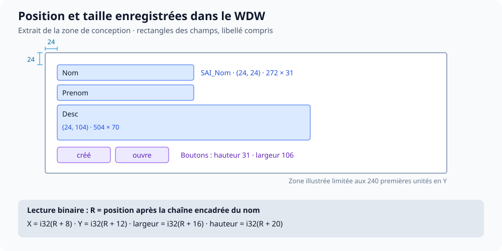
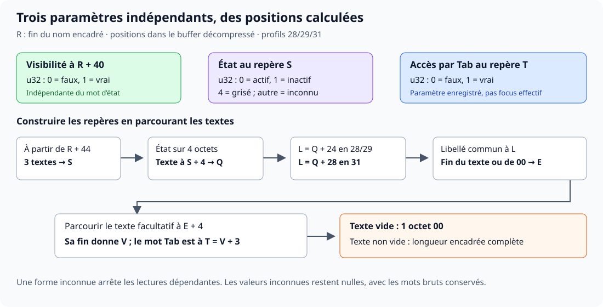

Le WDW rassemble les propriétés d’une fenêtre, ses événements WLangage et une image de prévisualisation. Le lecteur expose le titre et les dimensions de la fenêtre, les rectangles et certains libellés des champs reconnus, ainsi que le BMP de prévisualisation.

Les positions sont exprimées en **octets**. Les inconnues sont indiquées comme telles ; voir les [conventions](../conventions.mdx).

Pour utiliser le lecteur, consulter la [documentation .NET](../../dotnet/index.mdx).

## Identification et portée

| Propriété | Valeur |
| --- | --- |
| Extension | `.wdw` |
| Type PCS | `0x00000002` |
| Versions étudiées | 15, 24, 25, 28, 29 et 31 |
| Sections | 12 |
| Descripteurs racine observés | 607 (15/24/25/28/29) ; 610 (31) |

Le corpus initial comprend 22 fenêtres applicatives et six gabarits, enregistrés en version 31. Les témoins 24/25/29 et la fenêtre différentielle 28 complètent ce corpus. Le témoin 28 permet notamment d’isoler la visibilité, l’état et l’accès par Tab.

## Carte complète de FEN_Journal.wdw

Taille : 168 298 octets. Début des sections : 241, soit `0x00F1`.

| Section | Tag (`u8`) | Début dans le fichier | Longueur (`u32`) | Blocs décodés | Commentaire |
| --- | --- | --- | --- | --- | --- |
| 0 | `0x00` | `0x00F1` (241) | 143 | Aucun bloc LZW identifié | Identité de la fenêtre |
| 1 | `0x11` | `0x0180` (384) | 28075 | +28 → 155383 octets | Buffer de propriétés graphiques |
| 2 | `0x02` | `0x6F2B` (28459) | 47024 | +4 → 288361 octets | Code et événements WLangage |
| 3 | `0x00` | `0x126DB` (75483) | 7354 | +0 → 27554 octets | Buffer auxiliaire LZW ; paramètres partiellement lisibles |
| 4 | `0x08` | `0x14395` (82837) | 84326 | +0 → 3540482 octets | BMP complet de prévisualisation, compressé par LZW |
| 5 | `0x13` | `0x28CFB` (167163) | 62 | Aucun bloc LZW identifié | Métadonnées auxiliaires |
| 6 | `0x00` | `0x28D39` (167225) | 0 | Aucun bloc LZW identifié | Vide |
| 7 | `0x00` | `0x28D39` (167225) | 0 | Aucun bloc LZW identifié | Vide |
| 8 | `0x19` | `0x28D39` (167225) | 1012 | +24 → 2737 octets | Données auxiliaires ; LZW éventuel à +24 |
| 9 | `0x0A` | `0x2912D` (168237) | 36 | +12 → 24 octets | Petit buffer auxiliaire, LZW à +12 |
| 10 | `0x00` | `0x29151` (168273) | 0 | Aucun bloc LZW identifié | Vide |
| 11 | `0x06` | `0x29151` (168273) | 25 | +0 → 35 octets | Petit buffer auxiliaire LZW |

## Section 0 : identité

Comme dans le WDP et le WDG, la section 0 commence par un mot brut de quatre octets égal à 7, puis une chaîne encadrée de nom à +4. Des métadonnées et un chemin de projet suivent.

Pour `FEN_Journal`, la section commence à 241 et la chaîne de nom à 245.

## Section 1 : enveloppe des propriétés

Dans FEN_Journal, l'enveloppe LZW commence à +28. Les 28 octets précédents ne sont pas entièrement interprétés :

| Offset section | Taille | Type | Octets / valeur observée | Commentaire |
| --- | --- | --- | --- | --- |
| `+0` | 4 | `octets[4]` | `00 00 00 00` | Sens inconnu |
| `+4` | 4 | `octets[4]` | `01 00 01 00` | Deux mots possibles ; sens non certifié |
| `+8` | 4 | `u32` | 28 063 | Égal à la taille de section moins 12 |
| `+12` | 4 | `u32` brut | 2 | Mot auxiliaire |
| `+16` | 4 | `octets[4]` | `07 00 06 00` | Mots internes possibles ; sens inconnu |
| `+20` | 4 | `u32` brut | 7 275 | Sens inconnu |
| `+24` | 4 | `u32` brut | 1 | Sens inconnu |
| `+28` | 11 | En-tête LZW | Méthode 04, `L = 28 036`, `U = 155 383` | Vérifié |
| `+39` | 28 036 | Flux LZW | Données encodées | Produit le buffer `D` de propriétés |

La décompression produit 155 383 octets. Le début du flux encodé est `F[423]`, soit `384 + 28 + 11`.

## Descripteur racine 610

Soit `C_n` la taille de la chaîne encadrée de nom, qui commence à `D[8]`, et `R = 8 + C_n` la position juste après cette chaîne :

| Offset dans `D` | Taille | Type | Champ / commentaire | Statut |
| --- | --- | --- | --- | --- |
| `+0` | 4 | `u32` brut | Valeur 0 dans l'exemple | Observé |
| `+4` | 4 | `u32` | Descripteur 610 | Vérifié pour les racines étudiées |
| `+8` | `C_n` | Chaîne encadrée | Nom de la fenêtre | Vérifié |
| `R + 0` | 8 | `octets[8]` | Identifiant brut | Sens précis inconnu |
| `R + 8` | 4 | `i32`, vue retenue | X | Vérifié sur les valeurs observées |
| `R + 12` | 4 | `i32`, vue retenue | Y | Vérifié sur les valeurs observées |
| `R + 16` | 4 | `i32`, vue retenue | Largeur | Vérifié |
| `R + 20` | 4 | `i32`, vue retenue | Hauteur | Vérifié |
| `R + 24` | 4 | `u32` brut | Deuxième valeur de largeur dans les exemples | Observé ; rôle exact non établi |
| `R + 28` | 4 | `u32` brut | Deuxième valeur de hauteur dans les exemples | Observé ; rôle exact non établi |
| `[R + 32, R + 571)` | 539 | `octets[539]` | Paramètres graphiques et auxiliaires non entièrement décodés | Inconnu |
| `R + 571` | Variable | Chaîne encadrée ou sentinelle 00 | Titre de la fenêtre | Vérifié pour cette révision |
| Après le titre | Variable | Chaînes et structures diverses | Icône, groupes et objets éventuels ; frontières complètes inconnues | Partiel |

Cette carte n'est appliquée que si le descripteur vaut 610 et que le nom racine correspond à la fenêtre. Le mot 610 ne doit pas être assimilé à un nombre de champs.

## Exemple chiffré : FEN_Journal

| Champ | Offset décodé | Taille | Valeur |
| --- | --- | --- | --- |
| Nom encadré | 8 | 24 | `FEN_Journal` |
| Identifiant brut | 32 | 8 | `11 22 33 44 55 66 77 88` (valeur fictive) |
| X | 40 | 4 | 0 |
| Y | 44 | 4 | 0 |
| Largeur | 48 | 4 | 1 177 |
| Hauteur | 52 | 4 | 752 |
| Copie de largeur observée | 56 | 4 | 1 177 |
| Copie de hauteur observée | 60 | 4 | 752 |
| Titre | 603 | 33 | `Notes SuperNoteExtra` |

Les dimensions sont celles décrites dans le buffer ; leur relation avec les unités physiques d'un écran, le facteur DPI et la taille de la zone cliente n'est pas entièrement certifiée.

### Comparaison avec FEN_Rapport1

| Champ | FEN_Journal | FEN_Rapport1 |
| --- | --- | --- |
| Taille du nom encadré | 24 | 25 |
| Fin du nom `R` | 32 | 33 |
| Position du champ largeur | 48 | 49 |
| Largeur | 1 177 | 354 |
| Hauteur | 752 | 126 |
| Position du titre | 603 | 604 |
| Titre | `Notes SuperNoteExtra` | `Rapport1` |

Les offsets varient dès que la longueur du nom varie. Recopier 48 comme position universelle de la largeur serait donc incorrect.

## Chaînes secondaires et contrôles

Quelques chaînes fictives illustrant le début du buffer de propriétés. Le titre `Notes SuperNoteExtra` occupe 33 octets encadrés ; les chemins utilisent `D:\Projet\` pour conserver les tailles indiquées :

| Offset dans `D` | Taille totale | Valeur | Commentaire |
| --- | --- | --- | --- |
| `0x0008` (8) | 24 | FEN_Journal | Chaîne encadrée ; rôle déterminé par le contexte |
| `0x025B` (603) | 33 | Notes SuperNoteExtra | Chaîne encadrée ; rôle déterminé par le contexte |
| `0x027C` (636) | 49 | D:\Projet\SuperNoteExtra\noteapp.ico | Chaîne encadrée ; rôle déterminé par le contexte |
| `0x02DE` (734) | 39 | GR_JourActuel GR_Passé  | Chaîne encadrée ; rôle déterminé par le contexte |
| `0x0374` (884) | 53 | D:\Projet\SuperNoteExtra\FEN_Journal.wdw | Chaîne encadrée ; rôle déterminé par le contexte |
| `0x0431` (1073) | 14 | ? | Chaîne encadrée ; rôle déterminé par le contexte |
| `0x0493` (1171) | 18 | _Menu | Chaîne encadrée ; rôle déterminé par le contexte |
| `0x07A4` (1956) | 26 | MENU_SansNom1 | Chaîne encadrée ; rôle déterminé par le contexte |
| `0x0AB4` (2740) | 41 | OPT_Marquer_comme_en_attente | Chaîne encadrée ; rôle déterminé par le contexte |
| `0x0AE9` (2793) | 37 | Marquer comme en attente | Chaîne encadrée ; rôle déterminé par le contexte |
| `0x0B0E` (2830) | 49 | D:\Projet\SuperNoteExtra\attente.png | Chaîne encadrée ; rôle déterminé par le contexte |
| `0x0E23` (3619) | 33 | OPT_Marquer_en_cours | Chaîne encadrée ; rôle déterminé par le contexte |

Les options de menu possèdent notamment des noms et des libellés encadrés. Exemple : `OPT_Marquer_comme_en_attente`, puis `Marquer comme en attente`, puis un chemin d'image. Cette proximité est observée ; elle ne constitue pas une description universelle de tous les contrôles.

## Inférence des catégories d'éléments

| Préfixe / identifiant | Catégorie suggérée | Niveau de certitude |
| --- | --- | --- |
| `BTN_`, `BT_` | Bouton | Inféré |
| `SAI_` | Saisie | Inféré |
| `LIB_` | Libellé | Inféré |
| `TABLE_` | Table graphique | Inféré |
| `COL_` | Colonne | Inféré |
| `IMG_` | Image | Inféré |
| `OPT_` | Option de menu | Inféré, corroboré par les exemples |
| `MENU_`, `_Menu` | Menu | Inféré |
| `GR_` | Groupe | Inféré |

Les noms peuvent être modifiés par le développeur. Un contrôle portant un nom sans ces préfixes peut exister ; un nom ressemblant à un préfixe n'est pas une preuve de type. Les rectangles et certains libellés sont désormais lus dans les descripteurs décrits ci-dessous. La hiérarchie parent/enfant et les autres propriétés de chaque contrôle ne sont pas entièrement décodées.

## Code et données auxiliaires

La section 2 produit 288 361 octets de code et métadonnées dans FEN_Journal. Les propriétaires d'événements permettent de retrouver certains noms de contrôles et procédures locales ; voir le [chapitre WLangage](./wlangage.mdx).

La section 3 reste partiellement interprétée. La section 4 est désormais identifiée : un BMP complet de prévisualisation, de 3 540 482 octets pour FEN_Journal. Ses en-têtes, masques et pixels sont décrits dans le [chapitre des prévisualisations](./previsualisation-bmp.mdx).

## Limites

Le titre et les dimensions du descripteur 610 sont identifiés. Les coordonnées des champs individuels, les styles, les liaisons de données, les images des contrôles individuels, les plans et la hiérarchie complète restent à cartographier. Les régions inconnues sont conservées dans les buffers décodés.

## Carte mesurée en version 29

| Section | Tag `u8` | Début dans `F` | Longueur | Bloc reconnu : offset relatif → longueur décodée |
| --- | --- | --- | --- | --- |
| 0 | 0 | 241 | 134 | Identité |
| 1 | 17 | 375 | 3 403 | +28 → 13 982 |
| 2 | 2 | 3 778 | 4 135 | +4 → 22 594, source WLangage |
| 3 | 0 | 7 913 | 740 | +0 → 1 834 |
| 4 | 8 | 8 653 | 14 876 | +0 → 1 920 066, BMP complet |
| 5 | 19 | 23 529 | 62 | Auxiliaire |
| 6 | 0 | 23 591 | 0 | Vide |
| 7 | 0 | 23 591 | 0 | Vide |
| 8 | 25 | 23 591 | 253 | +24 → 316 |
| 9 | 10 | 23 844 | 36 | +12 → 24 |
| 10 | 0 | 23 880 | 0 | Vide |
| 11 | 6 | 23 880 | 25 | +0 → 35 |
| Fin | — | 23 905 | 0 | Fin exclusive |

### Descripteur racine 607

Dans le premier buffer de propriétés décompressé `B`, le `u32` à **4** vaut **607**, au lieu de 610 dans le profil 31. La première chaîne encadrée commence à 8 et finit à 29.

| Offset dans `B` | Taille | Type | Valeur / sens |
| --- | --- | --- | --- |
| 37 | 4 | `i32` lu depuis `u32` | X : 0 |
| 41 | 4 | `i32` lu depuis `u32` | Y : 0 |
| 45 | 4 | `u32` | Largeur : 800 |
| 49 | 4 | `u32` | Hauteur : 600 |
| 592 | 17 | Chaîne encadrée | Titre de quatre caractères |

Le déplacement du titre est `fin_première_chaîne + 563`, contre `+571` dans le profil 31. Les coordonnées restent à `fin_première_chaîne + 8`. Le lecteur sélectionne le profil par la version et le descripteur ; il ne déplace pas arbitrairement toutes les propriétés de huit octets.

La [prévisualisation BMP](./previsualisation-bmp.mdx) confirme indépendamment 800 × 600, 32 bits, BGRX, compression 3 et pixels à +66 dans le BMP. Sa longueur vaut `66 + 800 × 600 × 4`. L’image est récupérée du WDW, sans génération d’une nouvelle image.

Les événements source contiennent les traitements d’ajout d’une personne et de relecture du premier enregistrement, avec affectation de NOM, PRENOM et DESC. Ces lignes sont lues comme des données ; aucun WLangage n’est exécuté.

## Profil de fenêtre observé en version 25

Le fichier mesure **9 888 octets**. Le répertoire commence comme dans le profil 29 : douze sections, charge utile à `F[241]`. Les tags 5 et 11 des sections vides 7 et 10 diffèrent du témoin 29 ; leur absence de charge utile ne permet pas d’en attribuer la fonction.

| Section | Tag `u8` | Début dans `F` | Longueur stockée | Bloc : offset dans la section → octets décodés |
| --- | --- | --- | --- | --- |
| 0 | 0 | 241 | 134 | — |
| 1 | 17 | 375 | 2848 | +28 → 10611 |
| 2 | 2 | 3223 | 2272 | +4 → 13398 |
| 3 | 0 | 5495 | 612 | +0 → 1433 |
| 4 | 8 | 6107 | 3366 | +0 → 67866 |
| 5 | 19 | 9473 | 62 | — |
| 6 | 0 | 9535 | 0 | — |
| 7 | 5 | 9535 | 0 | — |
| 8 | 25 | 9535 | 292 | +24 → 412 |
| 9 | 10 | 9827 | 36 | +12 → 24 |
| 10 | 11 | 9863 | 0 | — |
| 11 | 6 | 9863 | 25 | +0 → 35 |

### Racine : comparer les coordonnées plutôt que supposer un décalage

Soit `B` le premier buffer de propriétés décompressé et `E` la fin exclusive de sa première chaîne encadrée. Les nombres de cette table sont mesurés, et chaque ligne est un profil distinct.

| Champ | Type / taille | Témoin 25 | Témoin 29 | Profil 31 |
| --- | --- | --- | --- | --- |
| Mot initial auxiliaire | `u32`, 4 octets | Absent avant le descripteur | Présent à `B+0` | Présent à `B+0` |
| Descripteur racine | `u32`, 4 octets | 607 à `B+0` | 607 à `B+4` | 610 à `B+4` |
| Première chaîne | Encadrée, variable | `B+4`, fin `E=25` | `B+8`, fin `E=29` | `B+8`, fin variable |
| X, Y, largeur, hauteur | Quatre entiers 32 bits | `E+8`, donc 33, 37, 41, 45 | `E+8`, donc 37, 41, 45, 49 | `E+8` |
| Titre | Chaîne encadrée | `E+506 = B+531` | `E+563 = B+592` | `E+571` |

Le témoin 25 annonce X=0, Y=0, largeur=800 et hauteur=600. Le titre encadré à 531 mesure 17 octets, pour quatre caractères. Les positions de toutes les autres propriétés ne se déduisent pas d’une translation unique : la différence de titre dépasse celle du préfixe racine. Le lecteur exige la version, la position de la première chaîne et la valeur du descripteur avant d’exposer `Bounds` et `Caption`.

### Prévisualisation réduite

Le bloc de section 4 donne un **BMP standard de 67 866 octets**, au lieu d’un bitmap de la taille de la fenêtre :

| Offset dans le BMP | Taille | Type | Valeur mesurée |
| --- | --- | --- | --- |
| 0 | 2 | ASCII | `BM` |
| 2 | 4 | `u32` LE | 67 866 |
| 10 | 4 | `u32` LE | Début des pixels : 66 |
| 14 | 4 | `u32` LE | En-tête DIB : 40 |
| 18 / 22 | 4 chacun | `i32` LE | Largeur 150 / hauteur positive 113 |
| 28 | 2 | `u16` LE | 32 bits par pixel |
| 30 | 4 | `u32` LE | 3 : `BI_BITFIELDS` |
| 54 / 58 / 62 | 4 chacun | `u32` LE | Masques R=`0x00FF0000`, G=`0x0000FF00`, B=`0x000000FF` |
| 66 | 67 800 | Pixels BGRX | Lignes de bas en haut ; `150 × 113 × 4` |

Le BMP est réduit à 150 × 113 alors que les propriétés décrivent 800 × 600. Les dimensions de prévisualisation ne remplacent donc jamais les dimensions de fenêtre. L’enveloppe LZW et le BMP restent standards pour le profil reconnu ; aucun codec PNG/JPEG supplémentaire n’est nécessaire. La [page BMP](./previsualisation-bmp.mdx) décrit les contrôles et la conversion des pixels.

La section source contient **36 événements**, dont l’ajout des valeurs NOM, PRENOM et DESC avec `HAjoute`. Le tag de corps `0x14` et le tag de propriétaire `0x0B` sont décrits dans le [chapitre WLangage](./wlangage.mdx). Les noms de contrôles restent des indices pour `Elements`, sans décodage complet de leur hiérarchie.

## Profil de fenêtre observé en version 24

Le WDW 24 mesure **9 973 octets**, comporte **12 sections** et une charge utile à **241**. Sa racine utilise le même profil que le témoin 25 : le descripteur `u32 = 607` est à `B[0]`, et la première chaîne encadrée commence à `B[4]`, sans mot auxiliaire de quatre octets avant le descripteur.

| Section | Tag `u8` | Offset fichier | Octets stockés | Bloc reconnu : offset relatif → octets décodés |
| --- | --- | --- | --- | --- |
| 0 | 0 | 241 | 134 | — |
| 1 | 17 | 375 | 2811 | +28 → 10147 |
| 2 | 2 | 3186 | 2121 | +4 → 13353 |
| 3 | 0 | 5307 | 657 | +0 → 1504 |
| 4 | 8 | 5964 | 3552 | +0 → 67866 |
| 5 | 19 | 9516 | 62 | — |
| 6 | 0 | 9578 | 0 | — |
| 7 | 5 | 9578 | 0 | — |
| 8 | 25 | 9578 | 334 | +24 → 511 |
| 9 | 10 | 9912 | 36 | +12 → 24 |
| 10 | 11 | 9948 | 0 | — |
| 11 | 6 | 9948 | 25 | +0 → 35 |

| Champ dans le premier buffer de propriétés B | Offset | Taille / type | Valeur |
| --- | --- | --- | --- |
| Descripteur | 0 | 4, `u32` LE | 607 |
| Nom de fenêtre | 4 | 21, chaîne encadrée | Nom technique de huit caractères ; fin E=25 |
| X | 33 = E+8 | 4, `i32` lu depuis `u32` | 0 |
| Y | 37 | 4, `i32` lu depuis `u32` | 0 |
| Largeur | 41 | 4, `u32` | 800 |
| Hauteur | 45 | 4, `u32` | 600 |
| Titre | 531 = E+506 | 17, chaîne encadrée | Quatre caractères |

Le buffer de propriétés mesure **10 147 octets**, contre 10 611 pour le témoin 25. Les chemins de gabarits et les propriétés restantes diffèrent : cette égalité de racine ne justifie pas d’appliquer un décalage constant à tout le document.

La section 4 produit un BMP complet de **67 866 octets**, avec signature `BM`, pixels à **66**, dimensions **150 × 113**, profondeur **32 bits** et compression BMP **3 (`BI_BITFIELDS`)**. Les masques et le stockage BGRX sont identiques au profil 25 décrit plus haut. La fenêtre mesure pourtant **800 × 600** : le lecteur conserve séparément les dimensions de la fenêtre et celles de la miniature.

Le source compte **36 événements et 83 lignes**, avec propriétaires au tag `0x0B` et corps au tag `0x14`. Les contrôles et l’ajout de PERSONNE sont lisibles. Les styles complets, les coordonnées de chaque contrôle et la hiérarchie restent partiels ; aucune lecture de ces propriétés opaques n’est déduite de la seule version.

## Profil de fenêtre observé en version 15

Le WDW 15 mesure **9 968 octets**. Les douze sections commencent à **241** et utilisent encore les enveloppes LZW communes.

| Section | Tag `u8` | Début dans F | Octets stockés | Bloc reconnu : offset relatif → octets décodés |
| --- | --- | --- | --- | --- |
| 0 | 0 | 241 | 118 | — |
| 1 | 17 | 359 | 2763 | +28 → 9385 |
| 2 | 2 | 3122 | 1381 | +4 → 8371 |
| 3 | 0 | 4503 | 451 | +0 → 1100 |
| 4 | 8 | 4954 | 4695 | +0 → 67866 |
| 5 | 19 | 9649 | 53 | — |
| 6 | 0 | 9702 | 0 | — |
| 7 | 5 | 9702 | 0 | — |
| 8 | 25 | 9702 | 205 | +24 → 256 |
| 9 | 10 | 9907 | 36 | +12 → 24 |
| 10 | 11 | 9943 | 0 | — |
| 11 | 6 | 9943 | 25 | +0 → 35 |

### Racine et textes sans encadrement

Le buffer de propriétés B mesure **9 385 octets**. Les textes concernés sont des **CP1252 Z**, et non des chaînes encadrées. Le nom interne contient un caractère accentué ; la bibliothèque utilise ce nom enregistré, indépendamment de l’orthographe du nom de fichier.

| Champ dans B | Offset | Taille | Type / valeur |
| --- | --- | --- | --- |
| Descripteur racine | 0 | 4 | `u32` LE = 607 |
| Nom de fenêtre | 4 | 13 | CP1252 Z ; douze caractères, fin exclusive E=17 |
| X | 25 = E+8 | 4 | `i32` lu depuis `u32`, valeur 0 |
| Y | 29 | 4 | `i32` lu depuis `u32`, valeur 0 |
| Largeur | 33 | 4 | `u32`, valeur 800 |
| Hauteur | 37 | 4 | `u32`, valeur 600 |
| Titre | 486 = E+469 | 19 | CP1252 Z ; dix-huit caractères avec accent |

Le descripteur vaut aussi 607 dans les témoins 24/25/29, mais cela ne garantit ni l’encodage des chaînes ni le déplacement du titre. En 15, le lecteur utilise `E+469` ; les profils 24/25 utilisent `E+506` avec une première chaîne encadrée.

Les noms, catégories et autres textes trouvés dans les propriétés restent **des candidats** : sans signature d’encadrement, une suite terminée par NUL peut aussi provenir de données binaires. Le diagnostic `HeuristicLegacyStrings` le précise. Le nom racine, le titre et les dimensions utilisent leurs structures et offsets vérifiés ; les éléments de contrôles conservent leur qualification de catégories inférées. Les candidats ne constituent pas une cartographie complète des propriétés.

### Source et miniature

Le buffer source de **8 371 octets** restitue **23 événements et 57 lignes**. Le traitement d’ajout de PERSONNE est rattaché au propriétaire du bouton grâce à son nom à longueur explicite suivi du groupe `0x0A`. La chaîne « PROCEDURE » présente dans une autre structure n’est pas transformée artificiellement en ligne d’événement. Voir les [structures source 15](./wlangage.mdx#source-de-la-version-15--longueurs-explicites).

La section 4 donne un BMP standard de **67 866 octets**, miniature **150 × 113** de la fenêtre **800 × 600** : signature `BM`, DIB 40, pixels à 66, profondeur 32 bits, compression BMP 3 et masques BGRX déjà décrits. Les coordonnées et tailles des contrôles, styles et hiérarchie complète ne sont pas reconstitués.

## Position, taille et libellé des champs

Les champs reconnus contiennent un descripteur, une chaîne de nom, un identifiant interne brut et quatre entiers de géométrie. Cette structure a été recoupée dans les profils 24, 25, 28, 29 et 31. Elle ne s’applique pas automatiquement aux candidats CP1252 du profil 15.

### Repères et unités

Les positions de cette section sont relatives au **buffer décompressé de la section 1**, nommé `D`. Elles ne sont pas des positions dans le fichier compressé. Dans le témoin 29, la section commence à 375, l’enveloppe LZW à 403 et le flux à 414 ; sa sortie contient 13 982 octets. Il n’existe pas de simple addition pour convertir `D[4198]` en une position dans ce flux.

Soit `N` le début de la chaîne encadrée de nom, `C` sa longueur totale et `R = N + C` la première position après le nom.

| Position dans `D` | Taille | Type de lecture | Propriété | Statut |
| --- | --- | --- | --- | --- |
| `N - 4` | 4 | `u32` LE | Descripteur 607 en 24/25/28/29, 610 en 31 | Contrôle de profil |
| `N` | `C` | Chaîne encadrée PCS | Nom du champ | Encadrement vérifié |
| `R + 0` | 8 | `u64` LE brut | Identifiant interne | Aucune relation parent/enfant déduite |
| `R + 8` | 4 | `i32` LE | X | Coordonnée de conception |
| `R + 12` | 4 | `i32` LE | Y | Coordonnée de conception |
| `R + 16` | 4 | `i32` LE | Largeur | Valeur négative refusée comme profil reconnu |
| `R + 20` | 4 | `i32` LE | Hauteur | Valeur négative refusée comme profil reconnu |
| `R + 40` | 4 | Vue `u32` LE | Visibilité initiale | 0 = faux, 1 = vrai ; sens vérifié en 28 |
| Après `R + 44` | Variable | Chaînes facultatives et valeurs numériques | État et autres métadonnées | Parcours détaillé ci-dessous |

Les coordonnées négatives sont conservées. Le lecteur ne les divise pas par le facteur de réduction du BMP : ce sont les valeurs de conception enregistrées, pas les coordonnées après ancrage, changement de DPI ou modification par le code.

### Les cinq champs du témoin 29

| Nom | `N` | `R` | Position des quatre entiers | X | Y | Largeur | Hauteur | Libellé lu / position |
| --- | --- | --- | --- | --- | --- | --- | --- | --- |
| `SAI_Nom` | 4170 | 4190 | 4198, 4202, 4206, 4210 | 24 | 24 | 272 | 31 | `Nom` à 4266 |
| `SAI_Prenom` | 6989 | 7012 | 7020, 7024, 7028, 7032 | 24 | 64 | 272 | 31 | `Prenom` à 7088 |
| `SAI_Desc` | 9814 | 9835 | 9843, 9847, 9851, 9855 | 24 | 104 | 504 | 70 | `Desc` à 9911 |
| `BTN_SansNom1` | 11763 | 11788 | 11796, 11800, 11804, 11808 | 24 | 188 | 106 | 31 | `créé` à 12060 |
| `BTN_SansNom2` | 13599 | 13624 | 13632, 13636, 13640, 13644 | 140 | 188 | 106 | 31 | `ouvre` à 13896 |

Les valeurs sont celles du fichier étudié. Dans ces cinq champs, les paramètres reconnus de visibilité et d’accès par Tab valent vrai, et l’état enregistré vaut actif.

### Chaînes facultatives : calculer les positions suivantes

Un emplacement de texte reconnu occupe **un octet `00` lorsqu’il est vide**, ou une **chaîne encadrée PCS complète**, dont la longueur totale est donnée dans l’encadrement. Une autre forme arrête le parcours dépendant ; le lecteur ne cherche pas un marqueur plus loin pour retrouver artificiellement un alignement.

| Étape | Départ / calcul | Lecture | Résultat |
| --- | --- | --- | --- |
| 1 | `R + 44` | Trois emplacements de texte successifs | `S`, début de la valeur d’état |
| 2 | `S` | Vue `u32` LE sur 4 octets | Code d’état brut |
| 3 | `S + 4` | Un emplacement de texte | `Q`, position après ce texte |
| 4 | `Q + 24` en 28/29 ; `Q + 28` en 31 | Position du libellé commun | `L` |
| 5 | `L` | Un emplacement de texte | `E`, position après le libellé commun |
| 6 | `E + 4` | Un emplacement de texte supplémentaire | `V`, position après ce texte |
| 7 | `V + 3` | Vue `u32` LE sur 4 octets | Paramètre d’accès par Tab |

Le rôle de chacun des textes intermédiaires n’est pas entièrement attribué. Des noms de menus contextuels, bulles et valeurs ou chemins d’image ont été observés dans ces emplacements. Leur structure est parcourue sans exécuter ni suivre ces textes.

**Cas simple :** si les trois premiers emplacements sont vides, `S = R + 47`. Si le texte à `S + 4` est aussi vide, le libellé commun commence à `R + 76` en 28/29 et à `R + 80` en 31. Si le texte à `E + 4` est vide, l’accès par Tab se trouve à `E + 8`.

Les positions courtes `R + 47`, `R + 76` et `E + 8` ne sont donc pas des offsets universels. Le passage au descripteur 610 ajoute quatre octets avant le libellé commun ; une chaîne non vide ajoute sa longueur encadrée moins un octet au déplacement des champs suivants.

### Libellé différé des boutons

Le libellé commun peut être vide alors que le bouton porte un texte. Le lecteur reconnaît les positions suivantes lorsqu’une chaîne encadrée valide s’y trouve :

| Profil | Position du libellé de bouton | Portée vérifiée |
| --- | --- | --- |
| 24 | `E + 160` | Deux boutons du témoin |
| 25 | `E + 164` | Deux boutons du témoin |
| 28 | `E + 194` | Sept boutons du témoin différentiel |
| 29 | `E + 195` | Deux boutons du témoin |
| 31 | Position différée non appliquée | Des chaînes et propriétés supplémentaires déplacent le texte ; `Caption` du bouton peut rester à `null` |

Ces déplacements ne constituent pas une sérialisation complète du corps spécifique des boutons. Pour des variantes où les textes internes déplacent ce corps, un libellé peut rester inconnu même si l’état et l’accès par Tab sont reconnus.

Pour `SAI_Nom` en 29, `E = 4282`. Pour `BTN_SansNom1`, le libellé commun est l’octet nul à 11864, donc `E = 11865` et `E + 195 = 12060`. Le texte `créé` mesure six octets UTF-8 ; sa chaîne encadrée mesure 19 octets. Le lecteur ne choisit pas simplement la prochaine chaîne, qui peut être un nom de style ou un chemin d’image.

## Visibilité, état et accès par Tab

Le témoin 28 a été fourni avec les propriétés attendues de sept boutons. La comparaison sépare trois paramètres indépendants :

| Paramètre | Position calculée | Taille lue | Type de lecture | Valeurs interprétées |
| --- | --- | --- | --- | --- |
| Visibilité initiale | `R + 40` | 4 | Vue `u32` LE | 0 = invisible ; 1 = visible |
| État initial | `S` | 4 | Vue `u32` LE, potentiellement non alignée | 0 = actif ; 1 = inactif ; 4 = grisé |
| Accès par Tab | `T = V + 3` | 4 | Vue `u32` LE, potentiellement non alignée | 0 = non accessible ; 1 = accessible |

Les valeurs observées sont petites et les octets de poids fort sont nuls. Les vues retenues lisent quatre octets et conservent le mot entier : une valeur telle que 256 ne devient pas faux en ne regardant que son premier octet. Les autres mots restent bruts et leur interprétation typée vaut `null`. Les codes d’état sont ceux observés dans le WDW ; ils ne sont pas présentés comme les valeurs numériques des constantes WLangage.

`State` n’est pas calculé à partir du nom du contrôle. Modifier le mot d’état d’un bouton nommé « actif » lui donne bien l’état inactif dans le lecteur. De même, un bouton invisible peut conserver le code d’état 0 et le paramètre Tab à 1. `IsTabStop` décrit le paramètre enregistré ; il ne garantit pas qu’un contrôle invisible ou inactif recevra effectivement le focus à l’exécution.

### Profil différentiel 28 : enveloppe et racine

Le fichier mesure **45 521 octets**. La section 1 produit un buffer de **15 905 octets**. Les débuts ci-dessous sont absolus dans le fichier `F` :

| Section | Tag `u8` | Début `F` | Longueur `u32` | Rôle / lecture |
| --- | --- | --- | --- | --- |
| 0 | 0 | 241 | 136 | Identité de fenêtre |
| 1 | 17 | 377 | 3616 | Enveloppe LZW à +28 ; flux à 416 ; sortie 15905 |
| 2 | 2 | 3993 | 2637 | Source et événements |
| 3 | 0 | 6630 | 866 | Buffer auxiliaire |
| 4 | 8 | 7496 | 37747 | Prévisualisation BMP décodée : 800 × 600, 1920066 octets |
| 5 | 19 | 45243 | 62 | Métadonnées auxiliaires |
| 6 | 0 | 45305 | 0 | Vide |
| 7 | 0 | 45305 | 0 | Vide |
| 8 | 25 | 45305 | 155 | Buffer auxiliaire |
| 9 | 10 | 45460 | 36 | Buffer auxiliaire |
| 10 | 0 | 45496 | 0 | Vide |
| 11 | 6 | 45496 | 25 | Buffer auxiliaire |
| Fin | — | 45521 | 0 | Couverture exacte |

Dans `D`, la racine porte le descripteur **607 à 4**. Le nom encadré commence à 8 et occupe 27 octets, donc sa fin est à 35. Les quatre entiers de géométrie commencent à 43 et donnent `(0, 0, 800, 600)`. Le titre commence à **598 = 35 + 563** et occupe 23 octets encadrés. Le lecteur ne traite plus cette racine 28 comme une racine 610.

### Les sept boutons : valeurs et positions exactes

Le premier nom est réellement enregistré `BTN_Bouton_isible`, sans le « v » de « visible ». Le bouton sans accès par Tab s’appelle `BTN_Bouton_sanstab` ; il est distinct de `BTN_Bouton_tab`.

| Nom enregistré | `N` | `R` | X | Y | Largeur | Hauteur | Visibilité | État | Tab |
| --- | --- | --- | --- | --- | --- | --- | --- | --- | --- |
| `BTN_Bouton_isible` | 3895 | 3925 | 6 | 6 | 94 | 24 | Vrai | Actif | Vrai |
| `BTN_Bouton_invisible` | 5814 | 5847 | 6 | 36 | 94 | 24 | Faux | Actif | Vrai |
| `BTN_Bouton_actif` | 7738 | 7767 | 106 | 6 | 94 | 24 | Vrai | Actif | Vrai |
| `BTN_Bouton_inactif` | 9654 | 9685 | 106 | 36 | 94 | 24 | Vrai | Inactif | Vrai |
| `BTN_Bouton_grisé` | 11574 | 11604 | 106 | 66 | 94 | 24 | Vrai | Grisé | Vrai |
| `BTN_Bouton_tab` | 13492 | 13519 | 206 | 6 | 156 | 24 | Vrai | Actif | Vrai |
| `BTN_Bouton_sanstab` | 15419 | 15450 | 206 | 36 | 156 | 24 | Vrai | Actif | Faux |

| Bouton | Mot de visibilité : offset / valeur | Mot d’état : offset / valeur | `E` | Mot Tab : offset / valeur | Libellé encadré : offset |
| --- | --- | --- | --- | --- | --- |
| `BTN_Bouton_isible` | 3965 / 1 | 3972 / 0 | 4002 | 4010 / 1 | 4196 |
| `BTN_Bouton_invisible` | 5887 / 0 | 5894 / 0 | 5924 | 5932 / 1 | 6118 |
| `BTN_Bouton_actif` | 7807 / 1 | 7814 / 0 | 7844 | 7852 / 1 | 8038 |
| `BTN_Bouton_inactif` | 9725 / 1 | 9732 / 1 | 9762 | 9770 / 1 | 9956 |
| `BTN_Bouton_grisé` | 11644 / 1 | 11651 / 4 | 11681 | 11689 / 1 | 11875 |
| `BTN_Bouton_tab` | 13559 / 1 | 13566 / 0 | 13596 | 13604 / 1 | 13790 |
| `BTN_Bouton_sanstab` | 15490 / 1 | 15497 / 0 | 15527 | 15535 / 0 | 15721 |

Dans ces sept cas, les trois textes avant l’état et les textes intermédiaires concernés sont vides : les formes courtes `S = R + 47`, `E = R + 77` et `T = R + 85` s’appliquent. Les libellés lus correspondent aux propriétés décrites, avec leurs accents UTF-8.

### Recoupement 29 et 31

| Profil | Descripteur enfant | Visibilité et état | Début du libellé commun sans texte intermédiaire | Accès par Tab |
| --- | --- | --- | --- | --- |
| 28 | 607 | Validation différentielle positive/négative fournie | `R + 76` | Validation différentielle positive/négative fournie |
| 29 | 607 | Valeurs des cinq champs compatibles avec les propriétés fournies | `R + 76` | Les cinq valeurs sont à 1 |
| 31 | 610 | Même parcours, y compris des états 1/4 et des contrôles cachés | `R + 80` | Les textes facultatifs doivent être parcourus avant de lire le mot |
| 30 | Non fourni | Aucune validation de fichier | Non affirmé | Non affirmé |
| 24/25 | 607 | Pas d’interprétation typée ajoutée pour ces versions | Rectangles et libellés conservés | Reste inconnu dans l’API |

Un contrôle 31 avec un nom de menu contextuel non vide a son état à **`S = R + 76`**, au lieu de `R + 47`. Avec son texte de bulle, son libellé commun se trouve à `R + 141` et son mot Tab à `R + 150`. Un contrôle image 31 a un chemin dans le texte à `E + 4` : le mot Tab est alors à `E + 56`, au lieu de `E + 8`. Ces formes sont testées sur le corpus ; elles montrent pourquoi les offsets courts ne doivent pas être appliqués sans lire les longueurs.

La confirmation sémantique différentielle vient du témoin 28 et des informations fournies pour 29. Le corpus 31 recoupe la structure et les valeurs, mais toutes les combinaisons possibles de propriétés, tous les types de champs et toutes les révisions du logiciel ne sont pas certifiés.

### Valeurs brutes et propriétés encore inconnues

`Layout.RawValues` conserve les vues numériques initiales : `u32(R + 24)` à `u32(R + 72)` tous les quatre octets, ainsi que certaines vues après `E`. Ce sont des fenêtres d’inspection, pas une description universelle de champs alignés. Si une chaîne facultative traverse une de ces vues, le nombre peut simplement représenter quatre octets de texte. Pour l’état et l’accès par Tab, utiliser les positions calculées de `Interaction`.

Les suites lues à `E + 24` ou `E + 29` dans le cas simple ne deviennent pas des ordres de tabulation certifiés. La propriété d’**accès** par Tab est maintenant isolée, mais le sens exact de ces numéros reste ouvert.

**L’opacité et le type de saisie restent non décodés.** Les noms comme `SAI_Nom` suggèrent une catégorie, pas la valeur de `TypeSaisie`. Les octets `64 02 00 00` du corps d’un bouton représentent 612 en lecture `u32` LE ; leur premier octet 100 ne suffit pas à identifier une opacité de 100 %.

Les références fonctionnelles de PC SOFT distinguent [l’état et ses constantes](https://doc.windev.com/en-US/?2514007=) et [le grisage](https://doc.windev.com/en-US/?1000019648=). Elles ne donnent pas ces positions binaires ; les offsets documentés ici proviennent de la comparaison des fichiers.

### Utilisation .NET

Les membres reconnus sont `WindevUiElement.Bounds`, `Caption`, `Layout`, `Interaction`, `IsVisible`, `State` et `IsTabStop`. Les paramètres typés inconnus valent `null` et les mots bruts restent accessibles. Les offsets de `Layout` et `Interaction` appartiennent au buffer décompressé associé à l’élément, identifié par `BufferOffset`.

L’inventaire initial reste fondé sur les noms et propriétaires d’événements. Si un nom apparaît comme référence avant sa description, le lecteur privilégie l’occurrence munie d’un descripteur reconnu. Les autres formats partageant `WindevUiElement`, comme les états WDE, ne reçoivent pas automatiquement le décodage WDW. Voir [l’exemple .NET](../../dotnet/documents-windev.mdx#visibilité-état-et-accès-par-tab).
